# HarnessRSI Daily

A research radar for **harness-level recursive self-improvement (RSI)**: systems that improve their own
*non-weight* components — prompts, skills, tools, workflows, memory, agent code, evaluators — from their own
execution feedback, and keep those changes for later tasks.

Lists of such papers already exist (e.g. [awesome-rsi](https://github.com/lobehub/awesome-rsi)). This repo goes
the other way: **depth over breadth**. It asks of each paper *what exactly improves, how the change is accepted,
and whether the evidence shows a real, retained improvement* — and it maps the field into recurring research
patterns, learned from the corpus itself.

> 中文简介：专门追踪「非权重层面的递归自我改进」（Harness RSI）。不做又一个论文列表，而是对每篇论文判定
> 它改了什么、怎么决定保留、证据是否真的支持"留存下来的提升"；并从语料中逆向归纳出 Harness 版的研究模式卡。

**Keywords:** recursive self-improvement (RSI) · self-improving agents · self-evolving agents · LLM agents · agent harness / scaffold optimization · harness engineering · prompt optimization (GEPA, DSPy, TextGrad) · agent memory & experience replay · skill library learning · agentic workflow search · automated design of agentic systems (ADAS) · Darwin Gödel Machine · open-ended evolution · tool creation · evaluator co-evolution · AI research agents · arXiv daily · awesome list · 递归自我改进 · 自我进化智能体 · 智能体框架优化 · 论文日报

<!-- REEL:START -->
## Poster gallery (40)

Posters and interpretations of top-scoring papers ([how they are made](reel/README.md)).

<table>
<tr><td align="center" width="33%"><a href="reel/2604.11811/poster.pdf">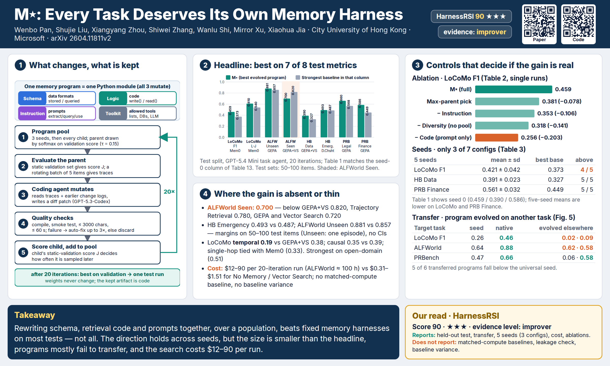</a> <b>M$^\star$</b> · 90 ★★★ <a href="reel/2604.11811/blog_zh.md">中文解读</a> · <a href="reel/2604.11811/blog_en.md">English</a> · <a href="https://arxiv.org/abs/2604.11811v2">paper</a></td><td align="center" width="33%"><a href="reel/2605.29668/poster.pdf">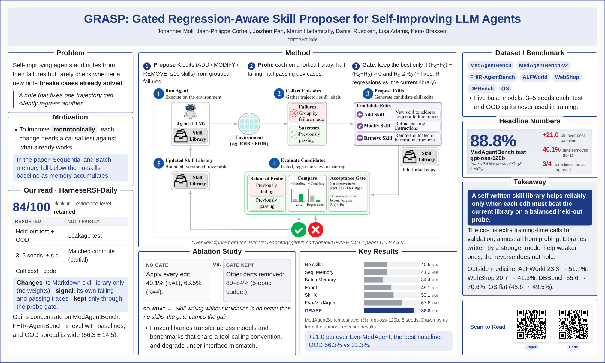</a> <b>GRASP</b> · 84 ★★★ <a href="reel/2605.29668/blog_zh.md">中文解读</a> · <a href="reel/2605.29668/blog_en.md">English</a> · <a href="https://arxiv.org/abs/2605.29668v3">paper</a></td><td align="center" width="33%"><a href="reel/2604.17708/poster.pdf">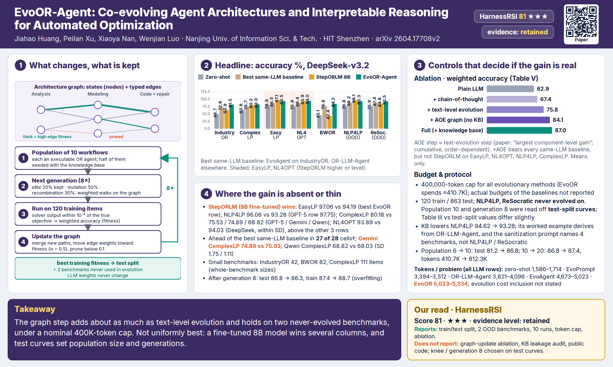</a> <b>Co-evolving Agent Architectures and Inte</b> · 81 ★★★ <a href="reel/2604.17708/blog_zh.md">中文解读</a> · <a href="reel/2604.17708/blog_en.md">English</a> · <a href="https://arxiv.org/abs/2604.17708v2">paper</a></td></tr>
<tr><td align="center" width="33%"><a href="reel/2608.23041/poster.pdf">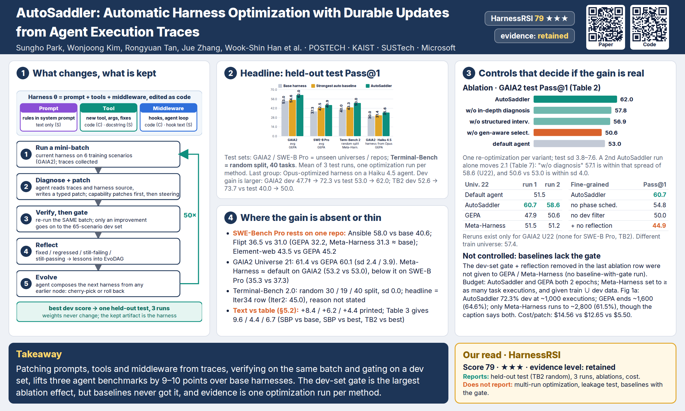</a> <b>AutoSaddler</b> · 79 ★★★ <a href="reel/2608.23041/blog_zh.md">中文解读</a> · <a href="reel/2608.23041/blog_en.md">English</a> · <a href="https://arxiv.org/abs/2608.23041v1">paper</a></td><td align="center" width="33%"><a href="reel/2610.18792/poster.pdf">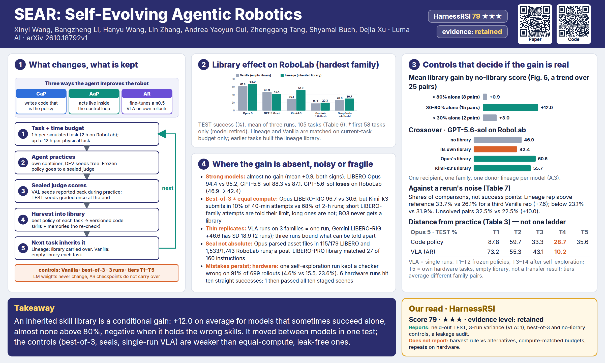</a> <b>SEAR</b> · 79 ★★★ <a href="reel/2610.18792/blog_zh.md">中文解读</a> · <a href="reel/2610.18792/blog_en.md">English</a> · <a href="https://arxiv.org/abs/2610.18792v1">paper</a></td><td align="center" width="33%"><a href="reel/2602.07755/poster.pdf">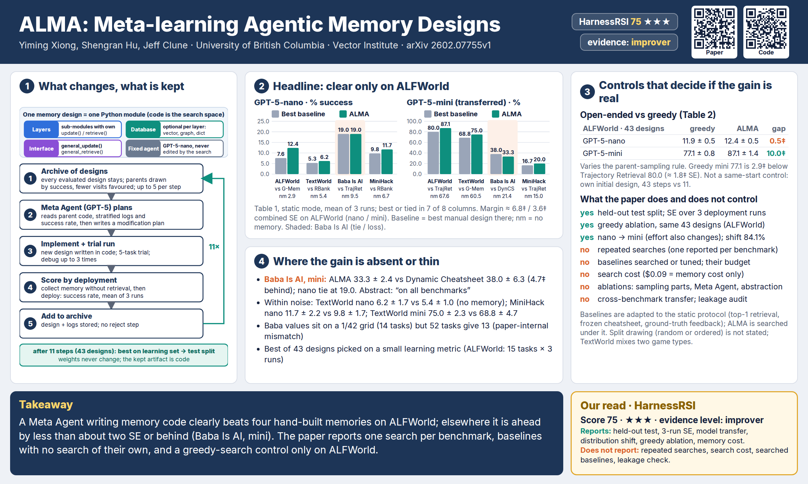</a> <b>Learning to Continually Learn via Meta-l</b> · 75 ★★★ <a href="reel/2602.07755/blog_zh.md">中文解读</a> · <a href="reel/2602.07755/blog_en.md">English</a> · <a href="https://arxiv.org/abs/2602.07755v1">paper</a></td></tr>
<tr><td align="center" width="33%"><a href="reel/2603.19461/poster.pdf">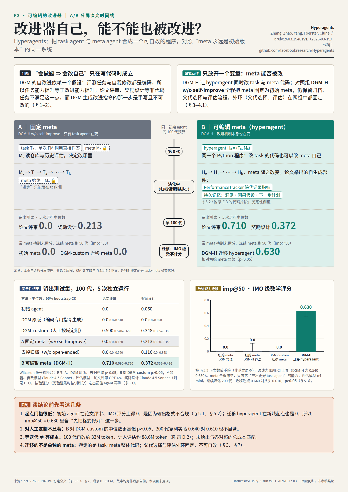</a> <b>Hyperagents</b> · 74 ★★★ <a href="reel/2603.19461/blog_zh.md">中文解读</a> · <a href="reel/2603.19461/blog_en.md">English</a> · <a href="https://arxiv.org/abs/2603.19461v1">paper</a></td><td align="center" width="33%"><a href="reel/2604.21725/poster.pdf">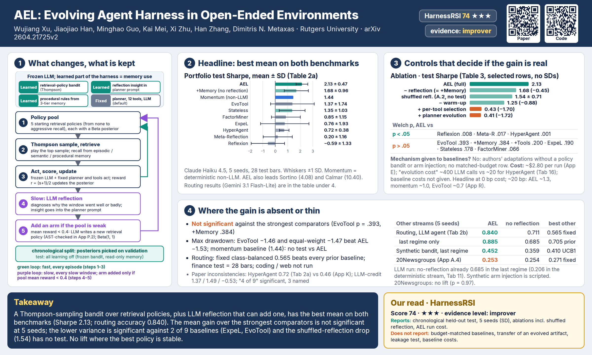</a> <b>AEL</b> · 74 ★★★ <a href="reel/2604.21725/blog_zh.md">中文解读</a> · <a href="reel/2604.21725/blog_en.md">English</a> · <a href="https://arxiv.org/abs/2604.21725v2">paper</a></td><td align="center" width="33%"><a href="reel/2605.19576/poster.pdf">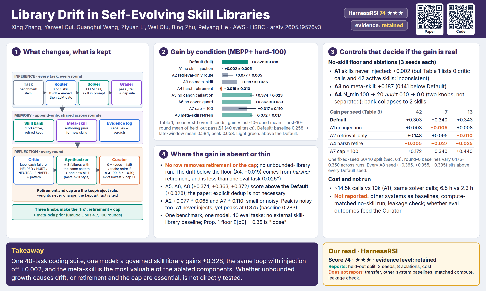</a> <b>Library Drift</b> · 74 ★★★ <a href="reel/2605.19576/blog_zh.md">中文解读</a> · <a href="reel/2605.19576/blog_en.md">English</a> · <a href="https://arxiv.org/abs/2605.19576v3">paper</a></td></tr>
<tr><td align="center" width="33%"><a href="reel/2610.13829/poster.pdf">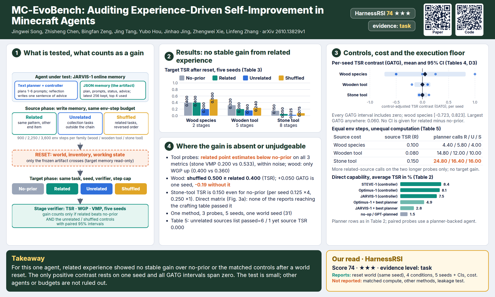</a> <b>MC-EvoBench</b> · 74 ★★★ <a href="reel/2610.13829/blog_zh.md">中文解读</a> · <a href="reel/2610.13829/blog_en.md">English</a> · <a href="https://arxiv.org/abs/2610.13829v1">paper</a></td><td align="center" width="33%"><a href="reel/2308.10144/poster.pdf">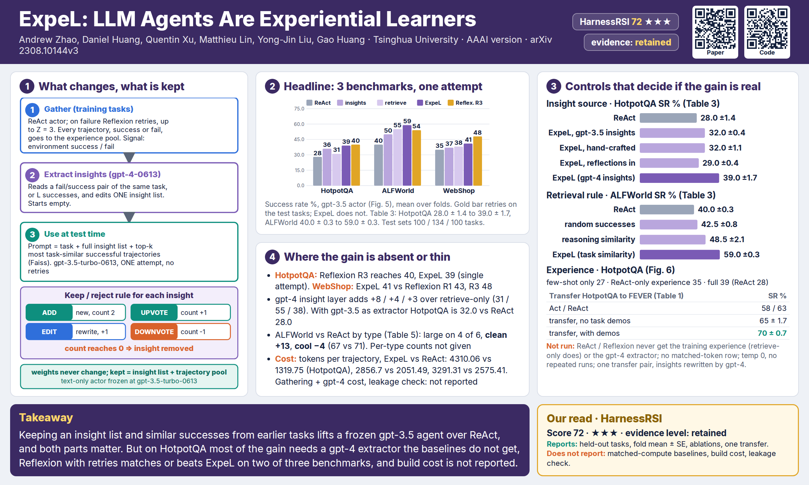</a> <b>ExpeL</b> · 72 ★★★ <a href="reel/2308.10144/blog_zh.md">中文解读</a> · <a href="reel/2308.10144/blog_en.md">English</a> · <a href="https://arxiv.org/abs/2308.10144v3">paper</a></td><td align="center" width="33%"><a href="reel/2605.22166/poster.pdf">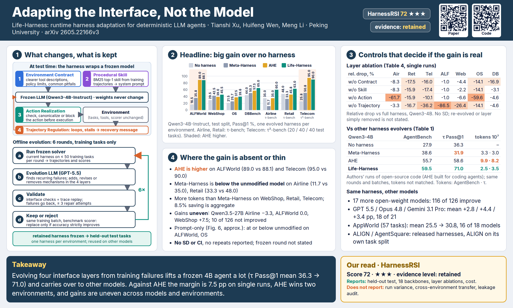</a> <b>Adapting the Interface, Not the Model</b> · 72 ★★★ <a href="reel/2605.22166/blog_zh.md">中文解读</a> · <a href="reel/2605.22166/blog_en.md">English</a> · <a href="https://arxiv.org/abs/2605.22166v3">paper</a></td></tr>
<tr><td align="center" width="33%"><a href="reel/2607.05202/poster.pdf">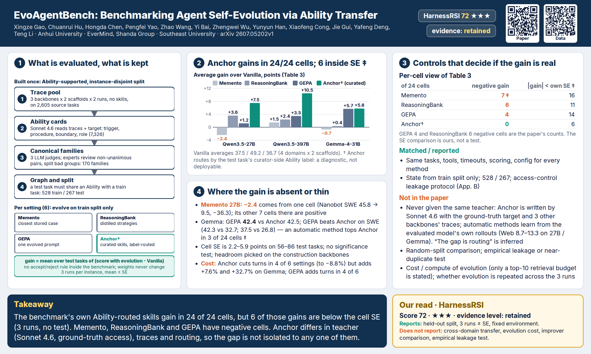</a> <b>EvoAgentBench</b> · 72 ★★★ <a href="reel/2607.05202/blog_zh.md">中文解读</a> · <a href="reel/2607.05202/blog_en.md">English</a> · <a href="https://arxiv.org/abs/2607.05202v1">paper</a></td><td align="center" width="33%"><a href="reel/2609.14857/poster.pdf">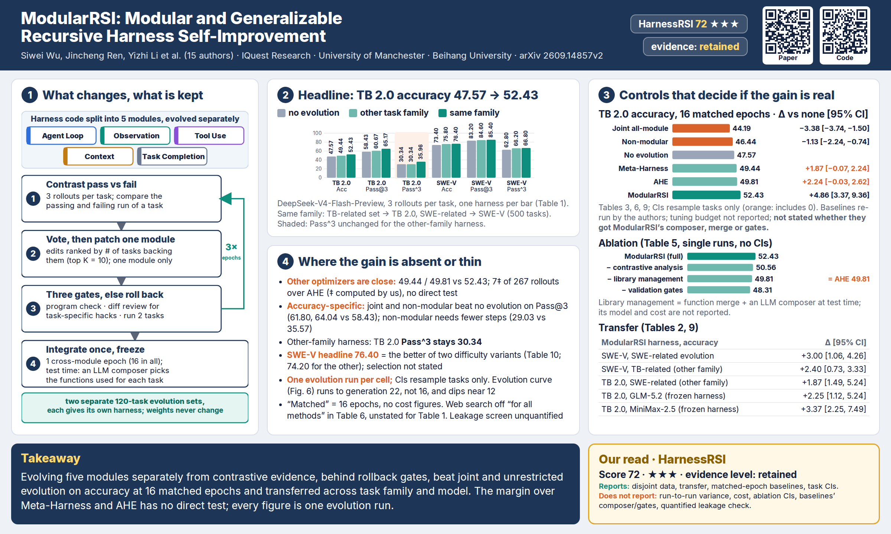</a> <b>ModularRSI</b> · 72 ★★★ <a href="reel/2609.14857/blog_zh.md">中文解读</a> · <a href="reel/2609.14857/blog_en.md">English</a> · <a href="https://arxiv.org/abs/2609.14857v2">paper</a></td><td align="center" width="33%"><a href="reel/2610.13991/poster.pdf">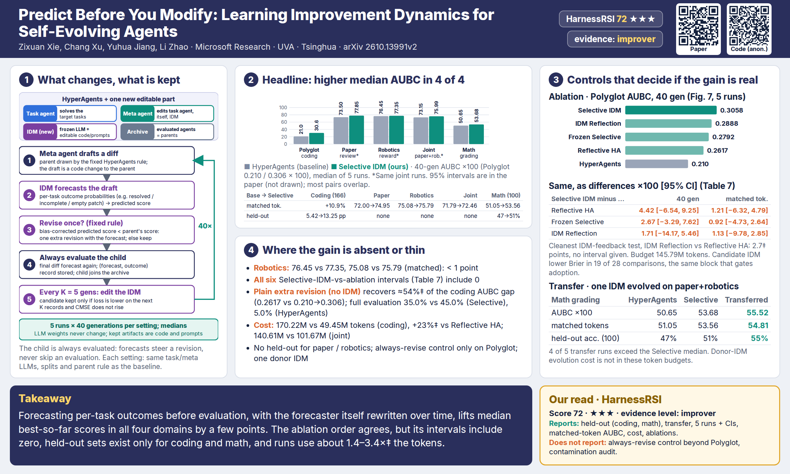</a> <b>Predict Before You Modify</b> · 72 ★★★ <a href="reel/2610.13991/blog_zh.md">中文解读</a> · <a href="reel/2610.13991/blog_en.md">English</a> · <a href="https://arxiv.org/abs/2610.13991v2">paper</a></td></tr>
<tr><td align="center" width="33%"><a href="reel/2606.16496/poster.pdf">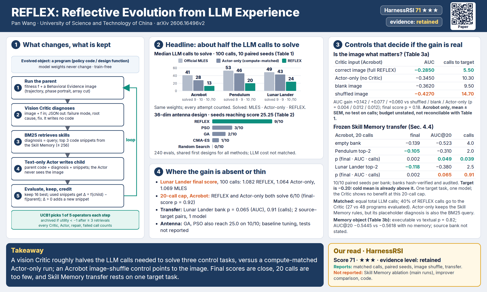</a> <b>REFLEX</b> · 71 ★★★ <a href="reel/2606.16496/blog_zh.md">中文解读</a> · <a href="reel/2606.16496/blog_en.md">English</a> · <a href="https://arxiv.org/abs/2606.16496v2">paper</a></td><td align="center" width="33%"><a href="reel/2608.04003/poster.pdf">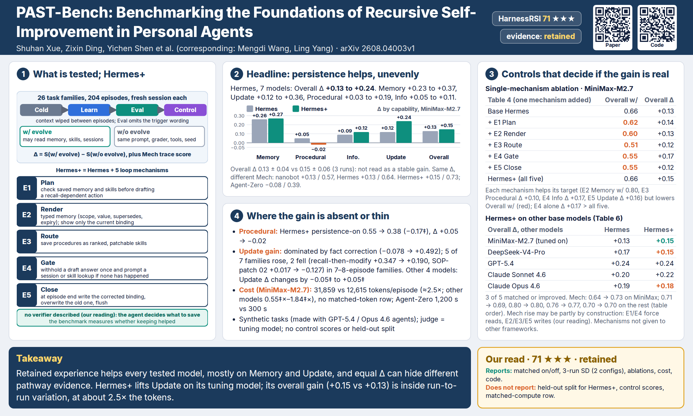</a> <b>PAST-Bench</b> · 71 ★★★ <a href="reel/2608.04003/blog_zh.md">中文解读</a> · <a href="reel/2608.04003/blog_en.md">English</a> · <a href="https://arxiv.org/abs/2608.04003v1">paper</a></td><td align="center" width="33%"><a href="reel/2602.02474/poster.pdf">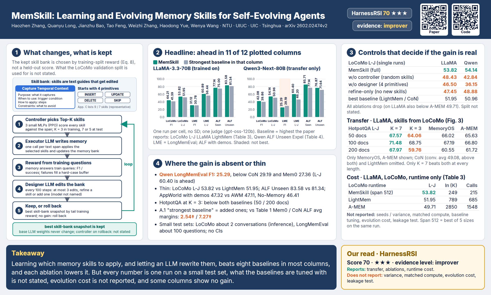</a> <b>MemSkill</b> · 70 ★★★ <a href="reel/2602.02474/blog_zh.md">中文解读</a> · <a href="reel/2602.02474/blog_en.md">English</a> · <a href="https://arxiv.org/abs/2602.02474v2">paper</a></td></tr>
<tr><td align="center" width="33%"><a href="reel/2606.04455/poster.pdf">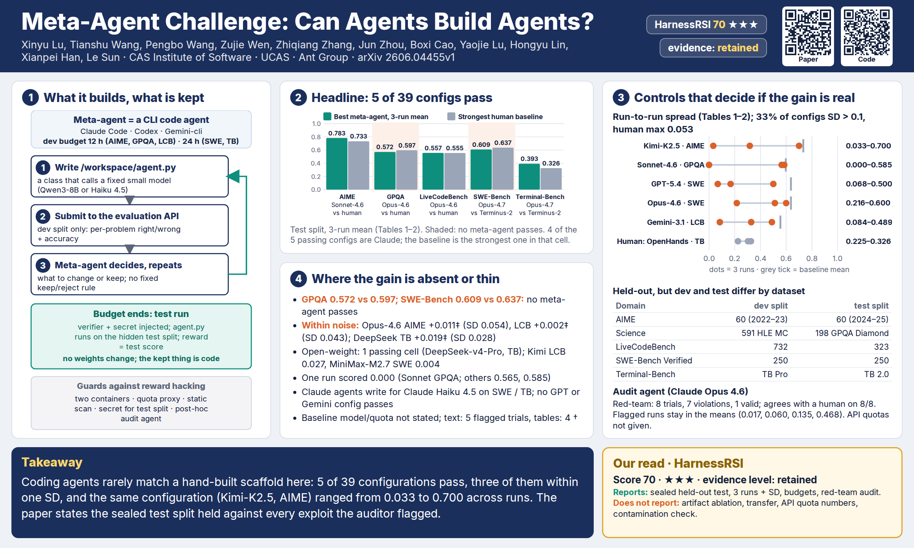</a> <b>The Meta-Agent Challenge</b> · 70 ★★★ <a href="reel/2606.04455/blog_zh.md">中文解读</a> · <a href="reel/2606.04455/blog_en.md">English</a> · <a href="https://arxiv.org/abs/2606.04455v1">paper</a></td><td align="center" width="33%"><a href="reel/2606.26294/poster.pdf">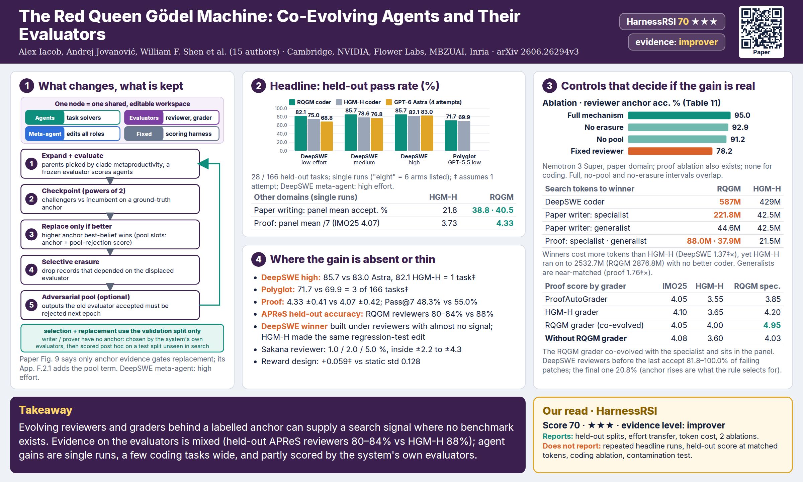</a> <b>The Red Queen Gödel Machine</b> · 70 ★★★ <a href="reel/2606.26294/blog_zh.md">中文解读</a> · <a href="reel/2606.26294/blog_en.md">English</a> · <a href="https://arxiv.org/abs/2606.26294v3">paper</a></td><td align="center" width="33%"><a href="reel/2604.00830/poster.pdf">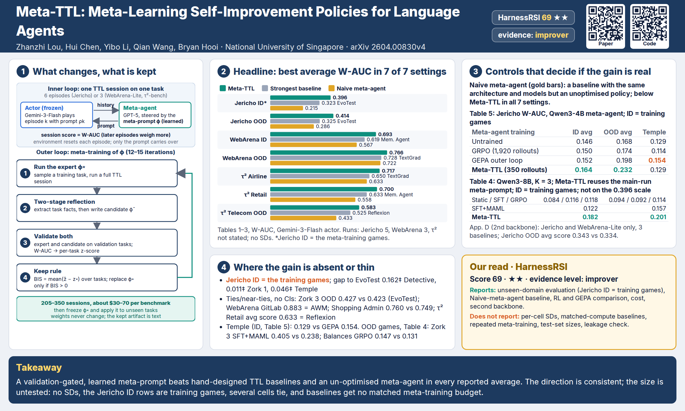</a> <b>Meta-TTL</b> · 69 ★★ <a href="reel/2604.00830/blog_zh.md">中文解读</a> · <a href="reel/2604.00830/blog_en.md">English</a> · <a href="https://arxiv.org/abs/2604.00830v4">paper</a></td></tr>
<tr><td align="center" width="33%"><a href="reel/2608.18933/poster.pdf">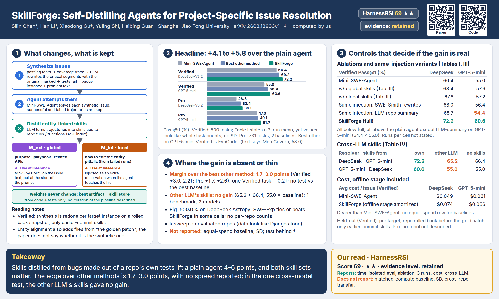</a> <b>SkillForge</b> · 69 ★★ <a href="reel/2608.18933/blog_zh.md">中文解读</a> · <a href="reel/2608.18933/blog_en.md">English</a> · <a href="https://arxiv.org/abs/2608.18933v1">paper</a></td><td align="center" width="33%"><a href="reel/2609.33867/poster.pdf">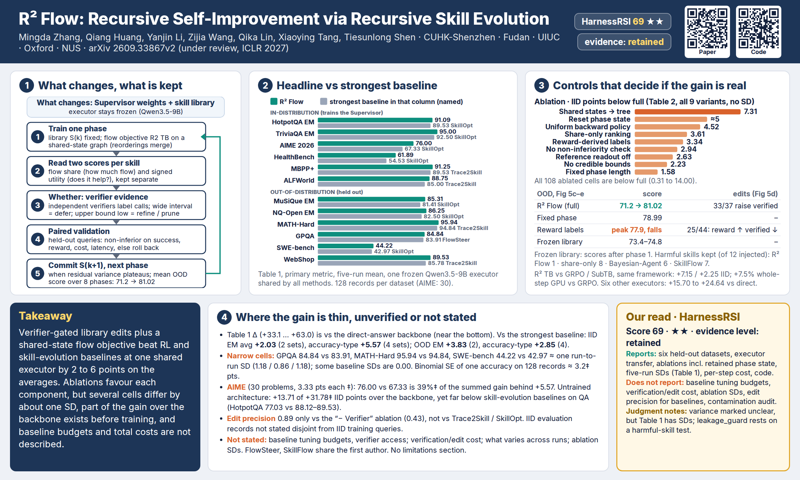</a> <b>R$^2$ Flow</b> · 69 ★★ <a href="reel/2609.33867/blog_zh.md">中文解读</a> · <a href="reel/2609.33867/blog_en.md">English</a> · <a href="https://arxiv.org/abs/2609.33867v2">paper</a></td><td align="center" width="33%"><a href="reel/2610.17860/poster.pdf">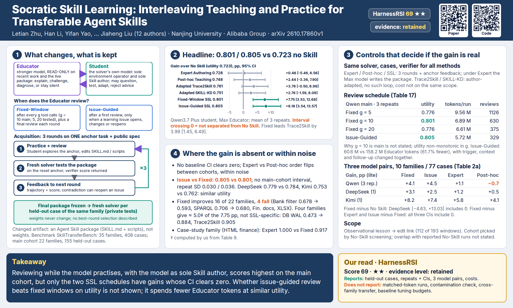</a> <b>Socratic Skill Learning</b> · 69 ★★ <a href="reel/2610.17860/blog_zh.md">中文解读</a> · <a href="reel/2610.17860/blog_en.md">English</a> · <a href="https://arxiv.org/abs/2610.17860v1">paper</a></td></tr>
<tr><td align="center" width="33%"><a href="reel/2606.17642/poster.pdf">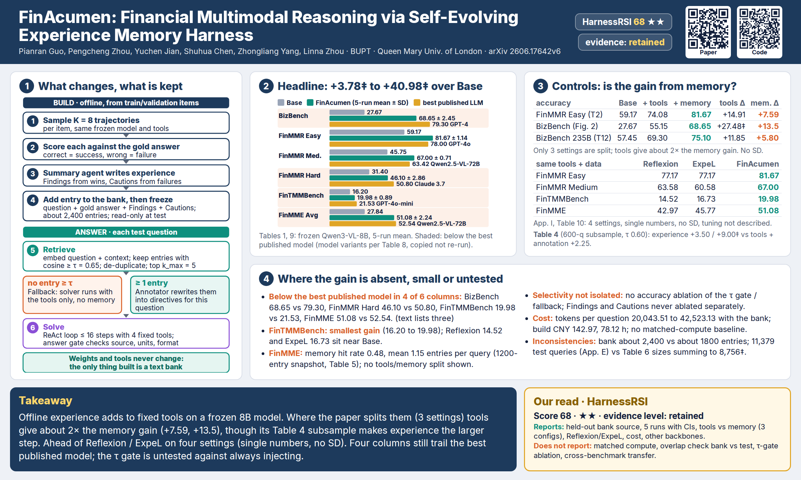</a> <b>FinAcumen</b> · 68 ★★ <a href="reel/2606.17642/blog_zh.md">中文解读</a> · <a href="reel/2606.17642/blog_en.md">English</a> · <a href="https://arxiv.org/abs/2606.17642v6">paper</a></td><td align="center" width="33%"><a href="reel/2609.05903/poster.pdf">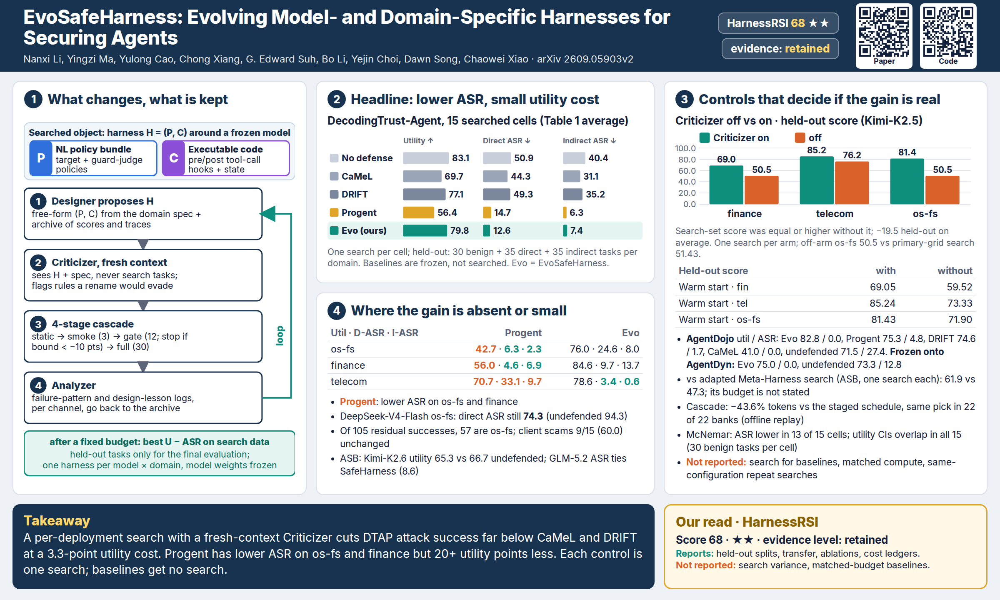</a> <b>EvoSafeHarness</b> · 68 ★★ <a href="reel/2609.05903/blog_zh.md">中文解读</a> · <a href="reel/2609.05903/blog_en.md">English</a> · <a href="https://arxiv.org/abs/2609.05903v2">paper</a></td><td align="center" width="33%"><a href="reel/2610.16125/poster.pdf">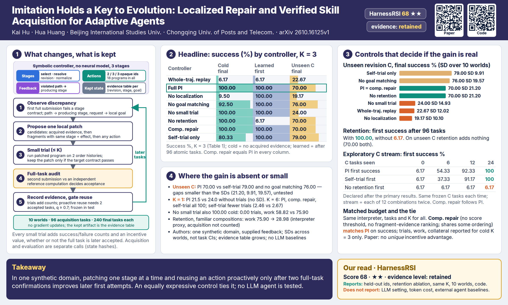</a> <b>Imitation Holds a Key to Evolution</b> · 68 ★★ <a href="reel/2610.16125/blog_zh.md">中文解读</a> · <a href="reel/2610.16125/blog_en.md">English</a> · <a href="https://arxiv.org/abs/2610.16125v1">paper</a></td></tr>
<tr><td align="center" width="33%"><a href="reel/2610.20786/poster.pdf">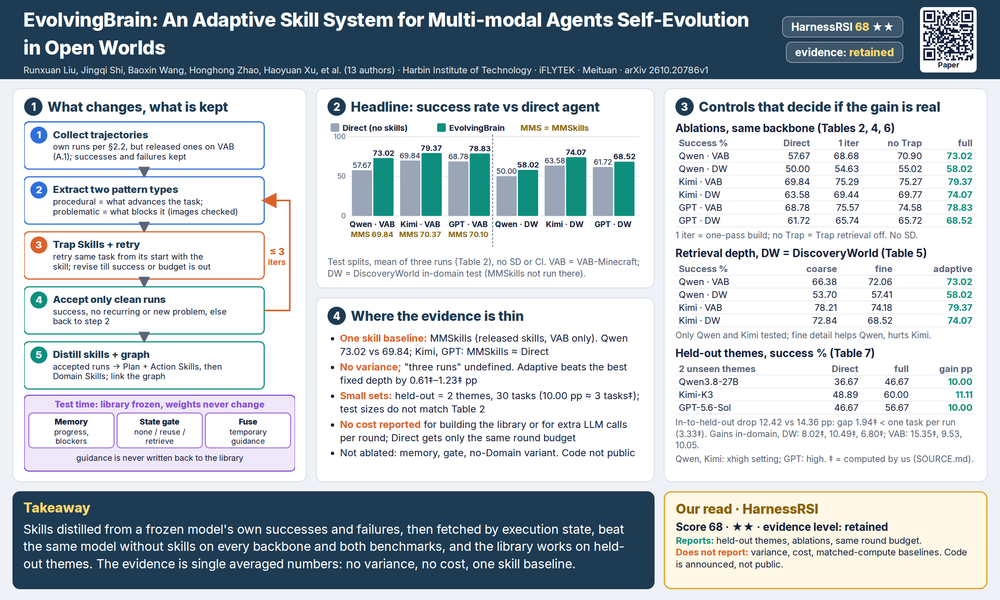</a> <b>EvolvingBrain</b> · 68 ★★ <a href="reel/2610.20786/blog_zh.md">中文解读</a> · <a href="reel/2610.20786/blog_en.md">English</a> · <a href="https://arxiv.org/abs/2610.20786v1">paper</a></td><td align="center" width="33%"><a href="reel/2203.07281/poster.pdf">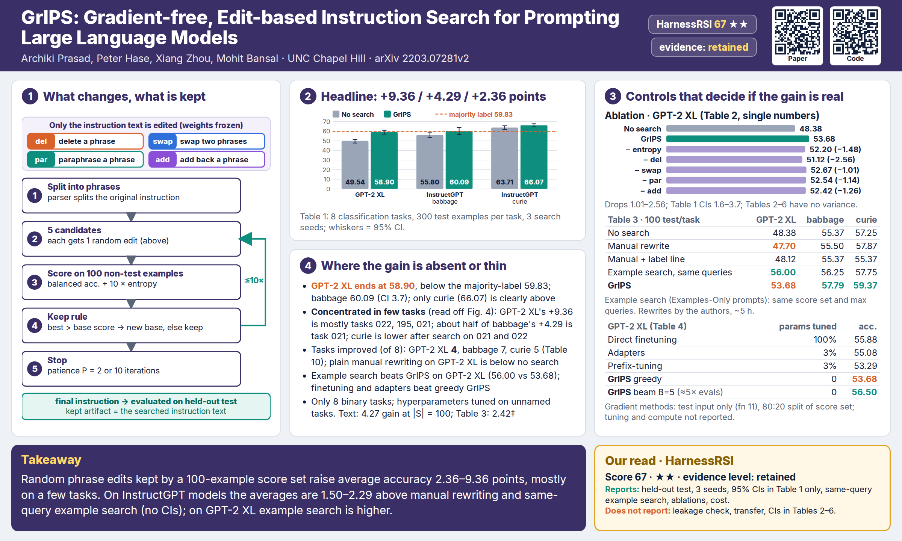</a> <b>GrIPS</b> · 67 ★★ <a href="reel/2203.07281/blog_zh.md">中文解读</a> · <a href="reel/2203.07281/blog_en.md">English</a> · <a href="https://arxiv.org/abs/2203.07281v2">paper</a></td><td align="center" width="33%"><a href="reel/2603.27850/poster.pdf">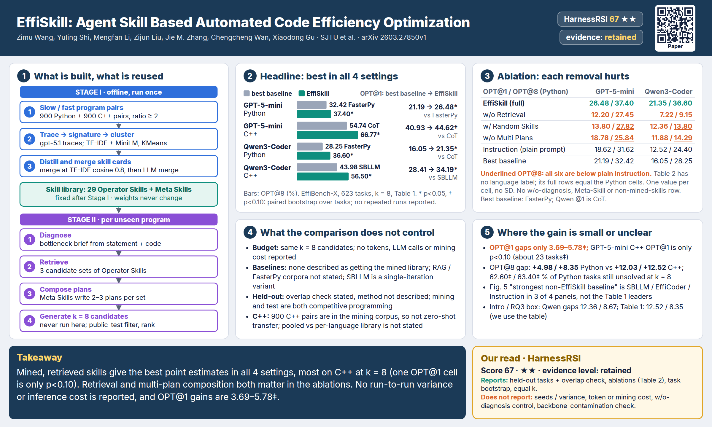</a> <b>EffiSkill</b> · 67 ★★ <a href="reel/2603.27850/blog_zh.md">中文解读</a> · <a href="reel/2603.27850/blog_en.md">English</a> · <a href="https://arxiv.org/abs/2603.27850v1">paper</a></td></tr>
<tr><td align="center" width="33%"><a href="reel/2604.14004/poster.pdf">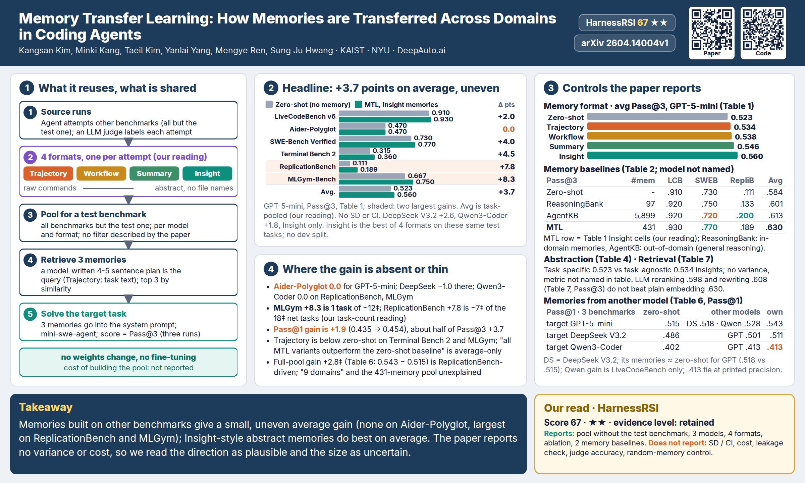</a> <b>Memory Transfer Learning</b> · 67 ★★ <a href="reel/2604.14004/blog_zh.md">中文解读</a> · <a href="reel/2604.14004/blog_en.md">English</a> · <a href="https://arxiv.org/abs/2604.14004v1">paper</a></td><td align="center" width="33%"><a href="reel/2606.09365/poster.pdf">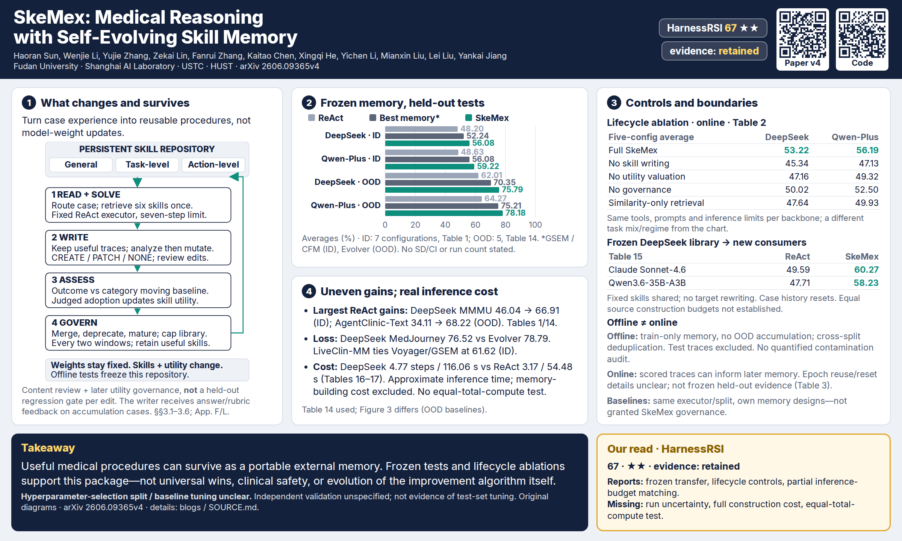</a> <b>Experience Makes Skillful</b> · 67 ★★ <a href="reel/2606.09365/blog_zh.md">中文解读</a> · <a href="reel/2606.09365/blog_en.md">English</a> · <a href="https://arxiv.org/abs/2606.09365v4">paper</a></td><td align="center" width="33%"><a href="reel/2606.28374/poster.pdf">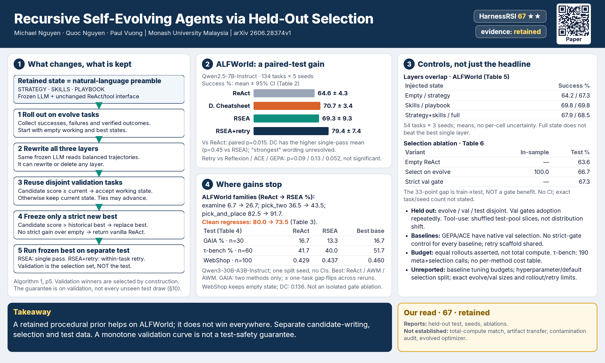</a> <b>Recursive Self-Evolving Agents via Held-</b> · 67 ★★ <a href="reel/2606.28374/blog_zh.md">中文解读</a> · <a href="reel/2606.28374/blog_en.md">English</a> · <a href="https://arxiv.org/abs/2606.28374v1">paper</a></td></tr>
<tr><td align="center" width="33%"><a href="reel/2606.30296/poster.pdf">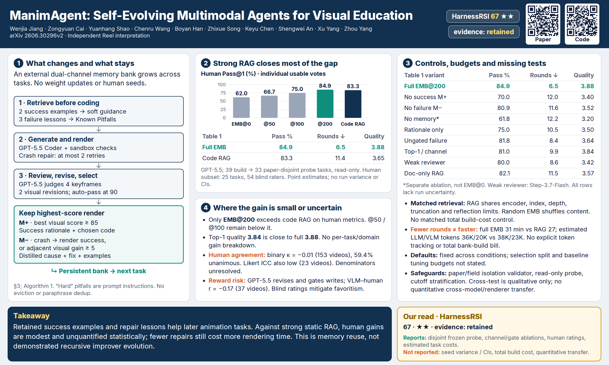</a> <b>ManimAgent</b> · 67 ★★ <a href="reel/2606.30296/blog_zh.md">中文解读</a> · <a href="reel/2606.30296/blog_en.md">English</a> · <a href="https://arxiv.org/abs/2606.30296v2">paper</a></td><td align="center" width="33%"><a href="reel/2608.24735/poster.pdf">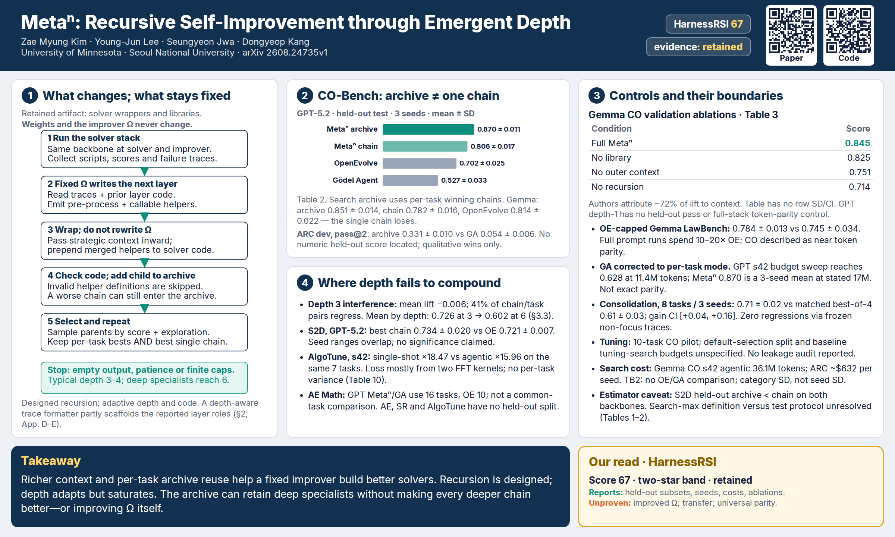</a> <b>Meta$^n$</b> · 67 ★★ <a href="reel/2608.24735/blog_zh.md">中文解读</a> · <a href="reel/2608.24735/blog_en.md">English</a> · <a href="https://arxiv.org/abs/2608.24735v1">paper</a></td><td align="center" width="33%"><a href="reel/2607.13683/poster.pdf">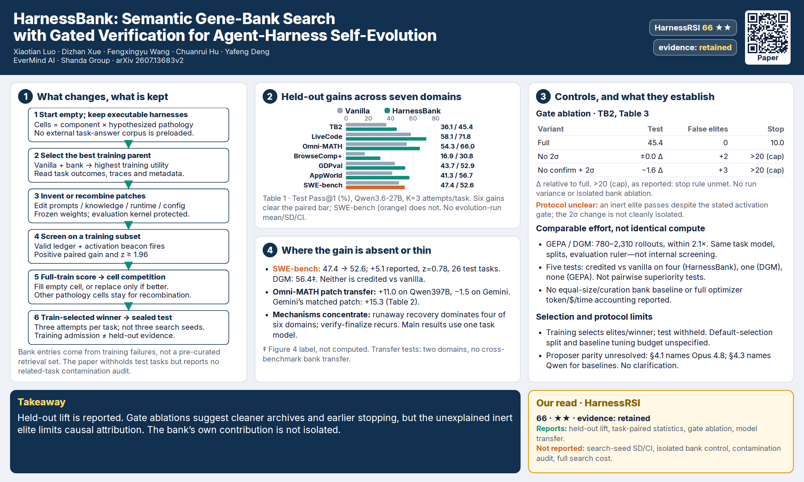</a> <b>HarnessBank</b> · 66 ★★ <a href="reel/2607.13683/blog_zh.md">中文解读</a> · <a href="reel/2607.13683/blog_en.md">English</a> · <a href="https://arxiv.org/abs/2607.13683v2">paper</a></td></tr>
<tr><td align="center" width="33%"><a href="reel/2609.04094/poster.pdf">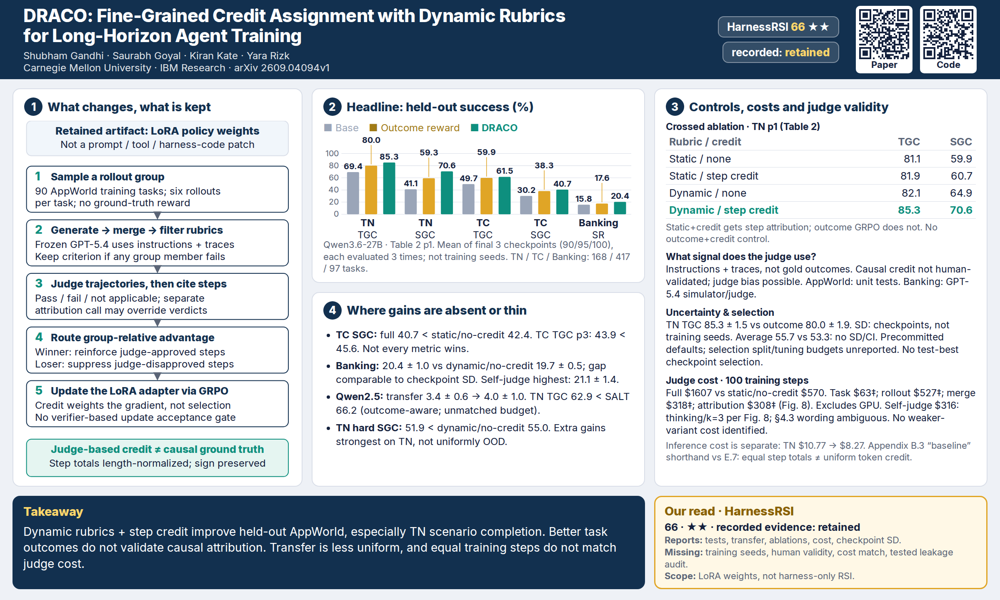</a> <b>DRACO</b> · 66 ★★ <a href="reel/2609.04094/blog_zh.md">中文解读</a> · <a href="reel/2609.04094/blog_en.md">English</a> · <a href="https://arxiv.org/abs/2609.04094v1">paper</a></td><td align="center" width="33%"><a href="reel/2509.09498/poster.pdf">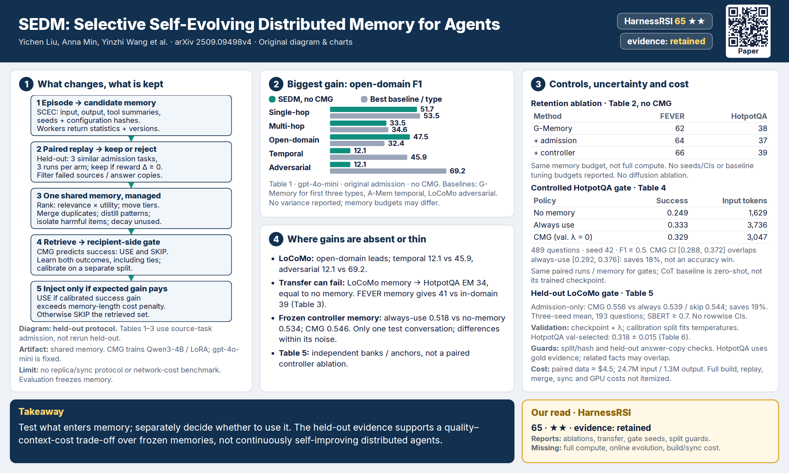</a> <b>SEDM</b> · 65 ★★ <a href="reel/2509.09498/blog_zh.md">中文解读</a> · <a href="reel/2509.09498/blog_en.md">English</a> · <a href="https://arxiv.org/abs/2509.09498v4">paper</a></td><td align="center" width="33%"><a href="reel/2510.16079/poster.pdf">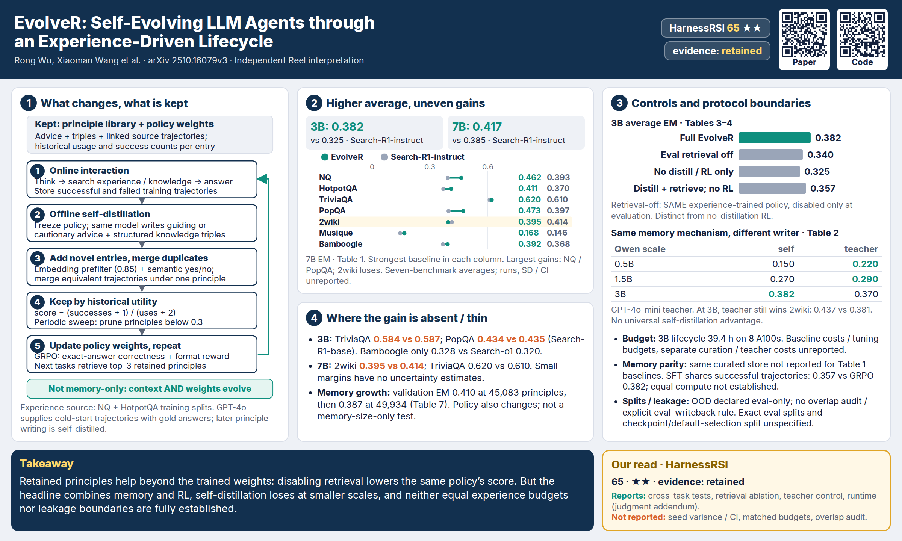</a> <b>EvolveR</b> · 65 ★★ <a href="reel/2510.16079/blog_zh.md">中文解读</a> · <a href="reel/2510.16079/blog_en.md">English</a> · <a href="https://arxiv.org/abs/2510.16079v3">paper</a></td></tr>
<tr><td align="center" width="33%"><a href="reel/2604.10923/poster.pdf">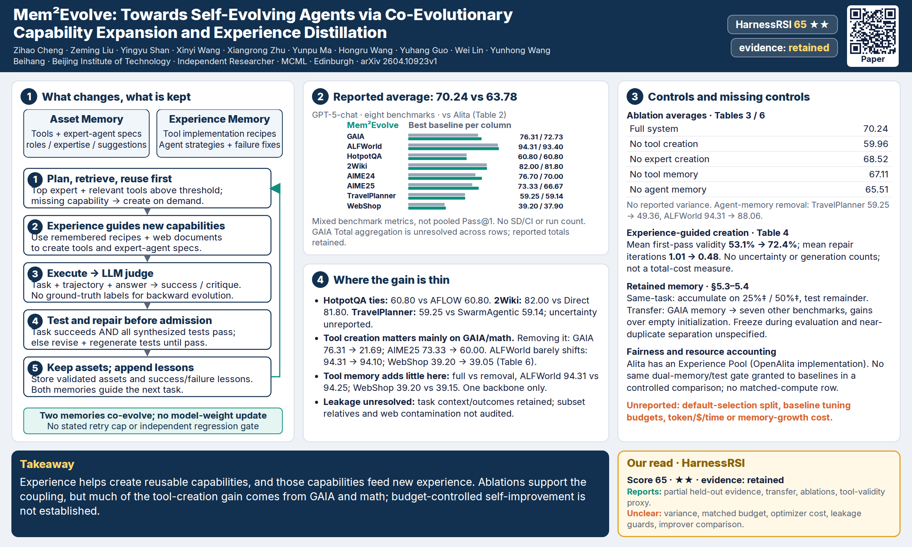</a> <b>Mem$^2$Evolve</b> · 65 ★★ <a href="reel/2604.10923/blog_zh.md">中文解读</a> · <a href="reel/2604.10923/blog_en.md">English</a> · <a href="https://arxiv.org/abs/2604.10923v1">paper</a></td></tr>
</table>
<!-- REEL:END -->

<!-- BOARD:START -->
## Top 30 papers by HarnessRSI score

Out of 689 scored so far (20 at ★★★ ≥ 70). Full board, grouped by pattern: [papers/](papers/README.md). Score (0–100) = **E**vidence (50) + e**X**ecution against the pattern card (30) + evidence **L**evel (10) + **C**ode (10); every judgment is quote-backed — see [SCORE_SPEC](research/SCORE_SPEC.md). It measures what a paper reports and how it executes its move, not the value of the idea.

| Date | Paper | Pattern | Score | Code |
|---|---|---|---|---|
| 2026-04-10 | **[M$^\star$: Every Task Deserves Its Own Memory Harness](https://arxiv.org/abs/2604.11811v2)** M*：每个任务都值得拥有自己的记忆框架 Evolves task-specific memory programs (Python schema, storage logic, instructions) via reflective coding-agent mutation over a softmax-sampled population, selected on static validation, reported on held-out test. | [H21](patterns/sub/H21.md) | **90** ★★★ E40 X30 L10 C10 | [code](https://github.com/wbopan/mstar) |
| 2026-05-28 | **[GRASP: Gated Regression-Aware Skill Proposer for Self-Improving LLM Agents](https://arxiv.org/abs/2605.29668v3)** GRASP：面向自我改进LLM智能体的门控回归感知技能提议器 Edits a bounded skill library from grouped failures, committing an edit only if it nets fixes over regressions on a held-out probe under a hard regression budget. | [H30](patterns/sub/H30.md) | **84** ★★★ E41 X27 L6 C10 | [code](https://github.com/jomoll/GRASP) |
| 2026-04-20 | **[Co-evolving Agent Architectures and Interpretable Reasoning for Automated Optimization](https://arxiv.org/abs/2604.17708v2)** 协同进化智能体架构与可解释推理以实现自动化优化 OR-agent workflows become AOE graphs; a fitness-weighted architecture graph is grown and pruned while a population of reasoning trajectories evolves by path recombination and semantic mutation. | [H17](patterns/sub/H17.md) | **81** ★★★ E45 X20 L6 C10 | — |
| 2026-08-24 | **[AutoSaddler: Automatic Harness Optimization with Durable Updates from Agent Execution Traces](https://arxiv.org/abs/2608.23041v1)** AutoSaddler：基于智能体执行轨迹的持久更新式自动Harness优化 Mini-batch harness optimization: an agent diagnoses failure traces with harness source, writes typed prompt/tool/middleware patches, verifies on the batch then a dev set, and logs lessons in an evolution DAG. | [H12](patterns/sub/H12.md) | **79** ★★★ E33 X30 L6 C10 | [code](https://github.com/microsoft/AutoSaddler) |
| 2026-10-13 | **[SEAR: Self-Evolving Agentic Robotics](https://arxiv.org/abs/2610.18792v1)** SEAR：自演化智能体机器人 SEAR measures inherited robot skills with budget-matched restarts, library removal, sealed test states, and cross-task and simulator transfer. | [H33](patterns/sub/H33.md) | **79** ★★★ E43 X27 L6 C3 | — |
| 2026-02-08 | **[Learning to Continually Learn via Meta-learning Agentic Memory Designs](https://arxiv.org/abs/2602.07755v1)** 通过元学习智能体记忆设计实现持续学习的学习 A meta agent samples an archive of code-level memory designs (update/retrieve), proposes new ones, scores each by a fixed agent's deployment success after memory collection. | [H21](patterns/sub/H21.md) | **75** ★★★ E28 X27 L10 C10 | [code](https://github.com/zksha/alma) |
| 2026-03-19 | **[Hyperagents](https://arxiv.org/abs/2603.19461v1)** 超智能体（Hyperagents） A single editable program holding task agent and meta agent rewrites both, including its own modification procedure; variants are archived DGM-style and scored on task performance. | [H20](patterns/sub/H20.md) | **74** ★★★ E31 X23 L10 C10 | [code](https://github.com/facebookresearch/Hyperagents) |
| 2026-04-23 | **[AEL: Evolving Agent Harness in Open-Ended Environments](https://arxiv.org/abs/2604.21725v2)** AEL：在开放式环境中进化智能体框架 Thompson-sampling bandit picks memory-retrieval policies per episode; slow LLM reflection diagnoses degradation and injects new retrieval policies as bandit arms; learning frozen at test. | [H21](patterns/sub/H21.md) | **74** ★★★ E32 X22 L10 C10 | [code](https://github.com/WujiangXu/AEL) |
| 2026-05-19 | **[Library Drift: Diagnosing and Fixing a Silent Failure Mode in Self-Evolving LLM Skill Libraries](https://arxiv.org/abs/2605.19576v3)** 库漂移：诊断并修复自演化LLM技能库中的一种静默失效模式 Frozen LLM writes, routes, and retires its own skills; outcome-driven retirement, bounded active cap and a meta-skill authoring prior govern which skills persist. | [H30](patterns/sub/H30.md) | **74** ★★★ E35 X23 L6 C10 | [code](https://github.com/amazon-science/Self-Evolving-Agents-Ratchet) |
| 2026-10-09 | **[MC-EvoBench: Auditing Experience-Driven Self-Improvement in Minecraft Agents](https://arxiv.org/abs/2610.13829v1)** MC-EvoBench：审计Minecraft智能体的经验驱动自我改进 MC-EvoBench freezes declared agent artifacts and resets worlds, comparing related, unrelated, shuffled, and absent experience under paired budgets. | [H33](patterns/sub/H33.md) | **74** ★★★ E39 X23 L2 C10 | [code](https://github.com/xzw-ustc/mc-bench-open-source) |
| 2023-08-20 | **[ExpeL: LLM Agents Are Experiential Learners](https://arxiv.org/abs/2308.10144v3)** ExpeL：大语言模型智能体是经验学习者 Agent gathers train-task trajectories, contrasts failures with successes into an insight list maintained by add/edit/upvote/downvote operations, and recalls insights plus successful trajectories on unseen tasks. | [H00](patterns/sub/H00.md) | **72** ★★★ E32 X24 L6 C10 | [code](https://github.com/LeapLabTHU/ExpeL) |
| 2026-05-21 | **[Adapting the Interface, Not the Model: Runtime Harness Adaptation for Deterministic LLM Agents](https://arxiv.org/abs/2605.22166v3)** 适配接口而非模型：确定性LLM智能体的运行时harness适配 An evolution LLM turns recurring training-trajectory failures into edits across four runtime-harness layers; a candidate replaces the incumbent only if training-batch accuracy improves, then freezes. | [H12](patterns/sub/H12.md) | **72** ★★★ E29 X27 L6 C10 | [code](https://github.com/Tianshi-Xu/Life-Harness) |
| 2026-07-06 | **[EvoAgentBench: Benchmarking Agent Self-Evolution via Ability Transfer](https://arxiv.org/abs/2607.05202v1)** EvoAgentBench：通过能力迁移评测智能体自进化 Benchmark builds trace-grounded Ability Graphs so every held-out task has train-side procedural support, then measures transfer gain of skill/memory/prompt evolution methods over no-evolution. | [H33](patterns/sub/H33.md) | **72** ★★★ E29 X27 L6 C10 | [code](https://huggingface.co/datasets/EverMind-AI) |
| 2026-09-14 | **[ModularRSI: Modular and Generalizable Recursive Harness Self-Improvement](https://arxiv.org/abs/2609.14857v2)** ModularRSI：模块化且可泛化的递归Harness自我改进 Evolves five harness modules independently on benchmark-disjoint tasks from contrastive success/failure trajectories voted across tasks, gated with rollback, then integrates modules into one harness. | [H12](patterns/sub/H12.md) | **72** ★★★ E29 X27 L6 C10 | [code](https://github.com/IQuestLab/ModularRSI) |
| 2026-09-26 | **[Predict Before You Modify: Learning Improvement Dynamics for Self-Evolving Agents](https://arxiv.org/abs/2610.13991v2)** 先预测再修改：学习自我进化智能体的改进动力学 An editable Improvement Dynamics Model forecasts task-level effects, guides revisions, and retains forecasting updates validated on subsequently collected modification outcomes. | [H21](patterns/sub/H21.md) | **72** ★★★ E29 X23 L10 C10 | — |
| 2026-06-15 | **[REFLEX: Reflective Evolution from LLM Experience](https://arxiv.org/abs/2606.16496v2)** REFLEX：基于LLM经验的反思式进化 Program evolution where a vision Critic diagnoses behavioral-evidence images, BM25 retrieves credited code snippets from a persistent Skill Memory, an Actor writes children; snippets credited by child-parent fitness change. | [H15](patterns/sub/H15.md) | **71** ★★★ E42 X23 L6 C0 | — |
| 2026-08-04 | **[PAST-Bench: Benchmarking the Foundations of Recursive Self-Improvement in Personal Agents](https://arxiv.org/abs/2608.04003v1)** PAST-Bench：评测个人智能体递归自我改进的基础能力 Benchmark of fresh-session task families with matched persistence-on/off runs and trace-level mechanism evidence; proposes Hermes+ with five memory/skill read-write interventions. | [H33](patterns/sub/H33.md) | **71** ★★★ E27 X28 L6 C10 | [code](https://github.com/Gen-Verse/PAST-Bench) |
| 2026-02-02 | **[MemSkill: Learning and Evolving Memory Skills for Self-Evolving Agents](https://arxiv.org/abs/2602.02474v2)** MemSkill：为自进化智能体学习并进化记忆技能 Memory operations become an evolving skill bank: RL controller selects skills, fixed LLM designer refines/adds skills from hard cases, rolling back skill banks that degrade performance. | [H21](patterns/sub/H21.md) | **70** ★★★ E27 X23 L10 C10 | [code](https://github.com/ViktorAxelsen/MemSkill) |
| 2026-06-03 | **[The Meta-Agent Challenge: Are Current Agents Capable of Autonomous Agent Development?](https://arxiv.org/abs/2606.04455v1)** 元智能体挑战：当前智能体能否自主开发智能体？ Benchmark where a code meta-agent iteratively programs an agent artifact against a dev-set evaluation API, scored on a hidden test split with anti-reward-hacking isolation and auditing. | [H34](patterns/sub/H34.md) | **70** ★★★ E27 X27 L6 C10 | [code](https://github.com/ant-research/meta-agent-challenge) |
| 2026-06-24 | **[The Red Queen Gödel Machine: Co-Evolving Agents and Their Evaluators](https://arxiv.org/abs/2606.26294v3)** 红皇后哥德尔机：智能体与其评估器的协同进化 Self-modifying agent search co-evolves learned evaluators in epochs; a challenger evaluator replaces the frozen one only if it scores higher on a held-out labeled anchor, erasing dependent records. | [H25](patterns/sub/H25.md) | **70** ★★★ E34 X23 L10 C3 | — |
| 2026-04-01 | **[Meta-TTL: Meta-Learning Self-Improvement Policies for Language Agents](https://arxiv.org/abs/2604.00830v4)** Meta-TTL：为语言智能体元学习自我改进策略 Meta-learns the natural-language meta-prompt governing cross-episode prompt rewriting via reflective meta-training; candidates replace the incumbent only if balanced validation TTL improvement is positive. | [H19](patterns/sub/H19.md) | **69** ★★ E26 X23 L10 C10 | [code](https://github.com/zzzlou/meta-ttl) |
| 2026-08-19 | **[SkillForge: Self-Distilling Agents for Project-Specific Issue Resolution](https://arxiv.org/abs/2608.18933v1)** SkillForge：面向项目特定问题修复的自蒸馏智能体 Before real issues arrive, an SWE agent solves test-grounded synthetic issues made by masked re-implementation of repo code, distilling entity-linked global and local skills injected on file access. | [H02](patterns/sub/H02.md) | **69** ★★ E31 X22 L6 C10 | [code](https://github.com/cslsolow/SkillForge) |
| 2026-09-27 | **[R$^2$ Flow: Recursive Self-Improvement via Recursive Skill Evolution](https://arxiv.org/abs/2609.33867v2)** R² Flow：通过递归技能进化实现递归自我改进 R² Flow uses independent verifier evidence and signed utility to admit versioned skill edits that reshape subsequent policy-learning rounds. | [H30](patterns/sub/H30.md) | **69** ★★ E33 X20 L6 C10 | [code](https://github.com/beita6969/r2flow) |
| 2026-10-13 | **[Socratic Skill Learning: Interleaving Teaching and Practice for Transferable Agent Skills](https://arxiv.org/abs/2610.17860v1)** 苏格拉底式技能学习：交错教学与练习以获得可迁移智能体技能 SSL interleaves read-only expert guidance with learner-owned experiments and skill writing, then tests frozen packages in fresh held-out sessions. | [H02](patterns/sub/H02.md) | **69** ★★ E27 X26 L6 C10 | [code](https://github.com/NJU-LINK/Socratic-Skill-Learning) |
| 2026-06-16 | **[FinAcumen: Financial Multimodal Reasoning via Self-Evolving Experience Memory Harness](https://arxiv.org/abs/2606.17642v6)** FinAcumen：基于自进化经验记忆框架的金融多模态推理 Financial VLM agent distills gold-scored training trajectories into a frozen memory of strategies and cautionary rules, injected only above a similarity threshold with fallback, alongside deterministic tools. | [H05](patterns/sub/H05.md) | **68** ★★ E29 X23 L6 C10 | [code](https://github.com/CamelliaLilium/FinAcumen) |
| 2026-09-05 | **[EvoSafeHarness: Evolving Model- and Domain-Specific Harnesses for Securing Agents](https://arxiv.org/abs/2609.05903v2)** EvoSafeHarness：为保障智能体安全演化特定于模型与领域的Harness A Designer evolves a safety policy bundle plus executable enforcement code from per-channel failure traces; a blind Criticizer rejects artifact-keyed rules and a cascade allocates evaluation. | [H12](patterns/sub/H12.md) | **68** ★★ E29 X23 L6 C10 | [code](https://github.com/SaFo-Lab/EvoSafeHarness) |
| 2026-10-12 | **[Imitation Holds a Key to Evolution: Localized Repair and Verified Skill Acquisition for Adaptive Agents](https://arxiv.org/abs/2610.16125v1)** 模仿是演化的关键：自适应智能体的局部修复与验证式技能获取 PI matches failed contracts to reusable action fragments, tests local repairs, and retains verified evidence for future first attempts. | [H03](patterns/sub/H03.md) | **68** ★★ E25 X27 L6 C10 | [code](https://github.com/FriendOfYishan/PI) |
| 2026-10-14 | **[EvolvingBrain: An Adaptive Skill System for Multi-modal Agents Self-Evolution in Open Worlds](https://arxiv.org/abs/2610.20786v1)** EvolvingBrain：开放世界多模态智能体的自适应技能自演化系统 Distills successful and failed trajectories into a persistent skill hierarchy, refines it through retries, and retrieves frozen skills according to execution state. | [H00](patterns/sub/H00.md) | **68** ★★ E29 X30 L6 C3 | — |
| 2022-03-14 | **[GrIPS: Gradient-free, Edit-based Instruction Search for Prompting Large Language Models](https://arxiv.org/abs/2203.07281v2)** GrIPS：面向大语言模型提示的无梯度、基于编辑的指令搜索 Greedy/beam local search applies random phrase-level edits (delete, swap, paraphrase, add) to task instructions, keeping the edit that raises balanced-accuracy-plus-entropy on a score set. | [H13](patterns/sub/H13.md) | **67** ★★ E31 X20 L6 C10 | [code](https://github.com/archiki/GrIPS) |
| 2026-03-29 | **[EffiSkill: Agent Skill Based Automated Code Efficiency Optimization](https://arxiv.org/abs/2603.27850v1)** EffiSkill：基于智能体技能的自动化代码效率优化 Mines operator and meta skills by contrasting slow/fast program pairs, clusters and merges them into a library, then retrieves and composes skills to optimize unseen programs. | [H00](patterns/sub/H00.md) | **67** ★★ E25 X26 L6 C10 | — |
<!-- BOARD:END -->

## What is here

| Path | What |
|---|---|
| [`papers/`](papers/README.md) | **Paper board**: every scored paper, grouped by pattern, with Chinese title, one-line summary, score breakdown and code link |
| [`cards/`](cards/) | Per-paper **diagnosis cards** (GEPA, RRSI, Harness² so far): mechanism, author-reported evidence, our diagnosis (held-out, budget, leakage, strongest rebuttal), code check at a pinned SHA |
| [`patterns/`](patterns/) | **Harness pattern cards** — start at [overview](patterns/overview.md): 13 [main patterns](patterns/main/) and 36 [sub-patterns](patterns/sub/) induced from the corpus, with accept-vs-reject contrast from ICLR, plus [anti-patterns](patterns/anti-patterns.md) |
| [`docs/EVIDENCE.md`](docs/EVIDENCE.md) | Scope (tier A/B), and the task / retained / improver evidence levels |
| [`docs/PIPELINE.md`](docs/PIPELINE.md) · [`docs/agents/`](docs/agents/ROLES.md) | How new papers flow in (collector → inbox → ingest → screen → signature → pattern → quote-backed judgment → score → board), and the prompts for the collector and maintainer agents |
| [`inbox/`](inbox/README.md) | Candidate papers waiting to be processed |
| [`docs/MAINTAINING.md`](docs/MAINTAINING.md) | Daily maintenance rules for the maintainer agent and humans |
| [`research/`](research/) | The reproducible pipeline and its data (see below) |
| `main.py`, `src/` | Daily arXiv fetch + LLM relevance scoring, inherited from [daily_arxiv_digest](https://github.com/yang3kc/daily_arxiv_digest) ([usage](docs/digest-pipeline.md)); topics set in `config.example.json`, keywords in `keywords.json` |

## How the pattern cards were built

The method mirrors how [ResearchStudio-Idea](https://github.com/microsoft/ResearchStudio) derived its ideation patterns
(signature extraction → pattern discovery → operational cards), adapted to harness RSI:

1. **Corpus.** Every arXiv paper cited by 7 public RSI / self-evolving-agent lists, plus anchor works: **1,198 papers**
   (`research/corpus.jsonl`). Lists contribute arXiv ids only.
2. **Screening** from abstracts into tier A (a harness-level self-improvement loop), B (a component usable inside one),
   C (out of scope, incl. weight-level self-improvement): **A 400 / B 185**.
3. **Contrast set.** Curated lists hold few rejected papers, so all ICLR 2025–2026 submissions matching harness-RSI
   terms were pulled from OpenReview — **including 406 rejected and 222 withdrawn** — and screened the same way (193 A/B).
4. **Signatures.** For each A/B paper: the problem, the assumption it drops, an operational signature, the
   load-bearing mechanism, what is evolved, how candidates are proposed, selected and retained.
5. **Pattern induction** over 585 signatures, with outcome labels withheld: **13 main patterns / 36 sub-patterns**.
   An independent re-assignment of 120 papers agreed on the main pattern 86% of the time (Cohen's κ = 0.84).
6. **Quote-grounded evidence** for 200 outcome-labeled papers: every non-"unclear" judgment carries a verbatim
   quote, mechanically checked against the paper text (`research/check_evidence.py`).
7. **Contrast.** Accept rates per pattern within ICLR 2025–2026 (base rate 35%), `research/patterns/contrast.md`.
8. **Cards** distilled from the above. Cards never name a paper; `research/check_patterns.py` verifies every count and Δ against `contrast.json` and greps for member titles.

The strongest finding: **single-document critique-and-rewrite (H10)** is accepted at ICLR far below base (17% vs 34%, n=30) — the only signal whose CI excludes the base rate in every view. For most other patterns, *membership* does not predict acceptance; *execution* does (see each card's "accepted vs rejected gap").

Pipeline state and decisions: [`research/PIPELINE.md`](research/PIPELINE.md).

## Caveats

- Screening, signatures and assignments are LLM-produced. Inter-rater agreement measures how clear the taxonomy is
  *given* the signatures, not whether the signatures are right.
- Acceptance is not quality, and n is small: read the confidence intervals in `contrast.md` before believing a Δ.
- Rejected papers come mostly from OpenReview and were read from abstracts only; evidence and limitations are therefore
  not comparable across outcomes, and cards compare accepted vs rejected work on mechanism only.
- ICLR reviews could not be fetched in this run (OpenReview rate limits); each main card's "Reviewer expectations"
  panel is derived from the quote-grounded evidence audit and is marked pending.
- Paper full texts were used locally and are not redistributed here. ICLR 2027 in-review submissions appear as ids and
  titles only.

## Credits and license

MIT (see [LICENSE](LICENSE)), inherited from [yang3kc/daily_arxiv_digest](https://github.com/yang3kc/daily_arxiv_digest).
Corpus seed lists: lobehub/awesome-rsi, ANative-Lab/Awesome-Self-Evolving-Agents, XMUDeepLIT/Awesome-Self-Evolving-Agents,
selfimproving-agent/Awesome-Self-Improving-Agents, wkqdzkd/Awesome-Reliable-Self-Evolving-Agents,
EvoMap/awesome-agent-evolution, iSEngLab/Awesome-Self-Evolving-Coding-Agents. Outcome labels from OpenReview.
