# HarnessRSI Daily

**A daily radar for harness-level recursive self-improvement (RSI)**: research where an agent changes and *keeps* a non-weight component — prompt, skill, tool, workflow, memory/playbook, agent code, evaluator or configuration — from execution feedback, and later tasks get better because of it.
（Harness 级递归自我改进雷达：追踪“基于执行反馈改变并留存非权重组件、之后任务因此变好”的一手研究。）

Core question: *which non-weight component was improved, how was the change accepted and retained, and did later tasks actually improve because of it?* Scope and evidence levels: [EVIDENCE](docs/EVIDENCE.md).
（核心问题：究竟改进了哪个非权重组件，如何接受并留存，之后的任务是否因此变好？）

> Current run: [`rsi-l1-20261022-03`](research/scoring/runs/rsi-l1-20261022-03/progress.md) · rules `problem-core-v1.1` · **1597 papers screened at L1 → 867 checked at L2 (350 + 517 extended) → 494 P3-confirmed candidates → 15 posters across two Reel issues.** Tiers rank reading priority. They are not peer review and do not endorse any venue.
> （档位是“值不值得读”的判断，不是审稿结论。）

**What this repo gives you（本项目贡献）**

- **13 pattern cards + 36 sub-cards** reverse-engineered from the RSI corpus: each records the operation, the field belief it runs into, and when it fails. They are the *only* source of rating criteria.
  （13 张主卡＋36 张子卡，从本语料逆向归纳；评分判据全部出自这些卡。）
- **A problem-first rating of the whole corpus**: every paper is first asked whether its question is real, open and consequential, then whether the mechanism's conditions hold — two layers, never summed.
  （全语料“先问问题、再看执行”的两层评价，不算总分。）
- **A short reading list and a Reel**: 228 confirmed good-question papers, of which 8 were checked against the full text and turned into source-mapped posters.
  （228 篇确认的好问题论文，其中 8 篇经原文核对做成逐数溯源的画报。）

## Featured Reel — Issue s001 (2026-10-22)（精选画报 · 第一期）

Eight papers, eight mechanism types. Each poster was checked against the paper's full text by Opus 5.5, with every number mapped to its section or table in `reel/<id>/SOURCE.md` and visual QA in `QA.md`. Selection log: [selection.md](research/scoring/runs/rsi-l1-20261022-03/selection.md) · [Reel index](reel/README.md).
（8 篇、8 类机制；每张经 Opus 5.5 原文核对、逐数溯源与视觉验收。）

<table>
<tr>
<td width="33%" align="center" valign="top">
<a href="reel/2601.22436/poster.png">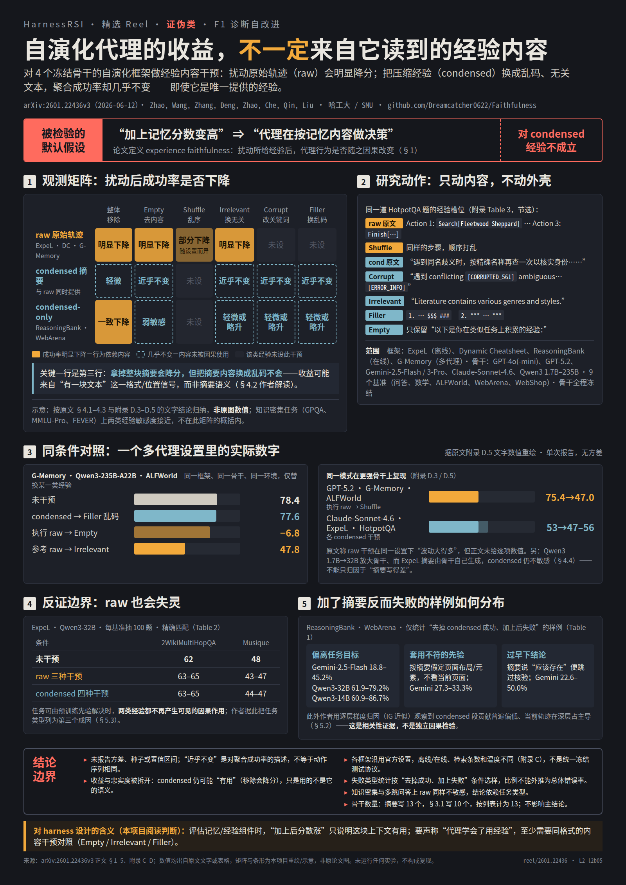</a> 
<b><a href="https://arxiv.org/abs/2601.22436">2601.22436</a> · Memory faithfulness</b> 
Seven content interventions across four frameworks: agents lean on raw trajectories but barely use condensed experience. 
七类内容干预：代理依赖原始轨迹，却基本不用压缩后的经验。
</td>
<td width="33%" align="center" valign="top">
<a href="reel/2603.28052/poster.png">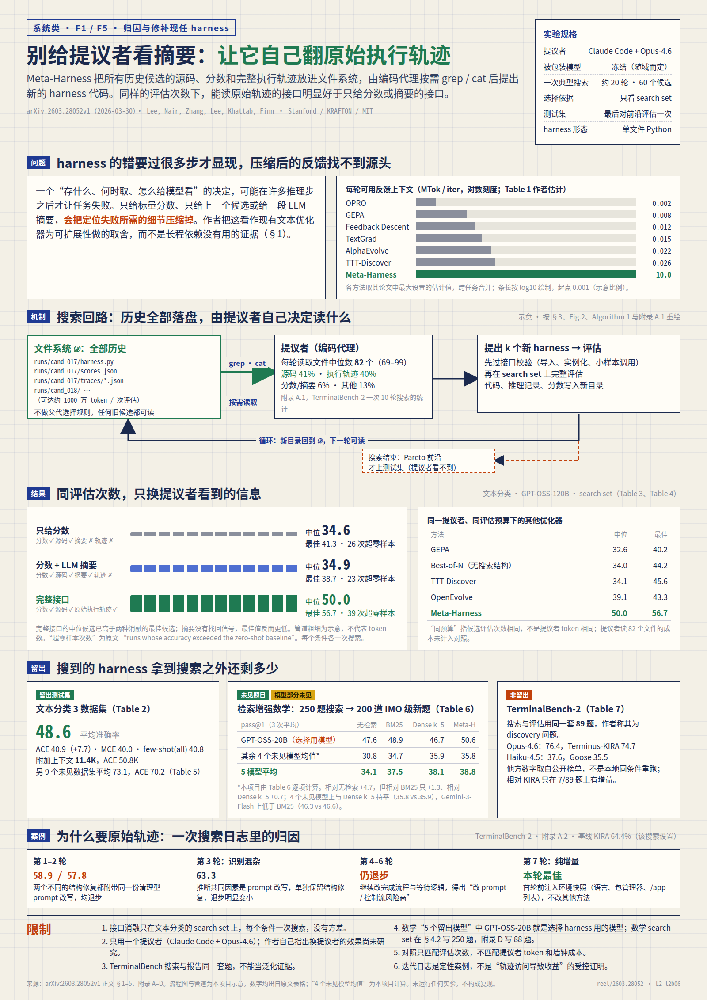</a> 
<b><a href="https://arxiv.org/abs/2603.28052">2603.28052</a> · Harness-search feedback</b> 
Same evaluation budget: a proposer that reads raw traces reaches a median of 50.0, vs 34.9 with score + summary. 
同评估预算下，能读原始轨迹的提议者中位 50.0，只给分数＋摘要为 34.9。
</td>
<td width="33%" align="center" valign="top">
<a href="reel/2602.05832/poster.png">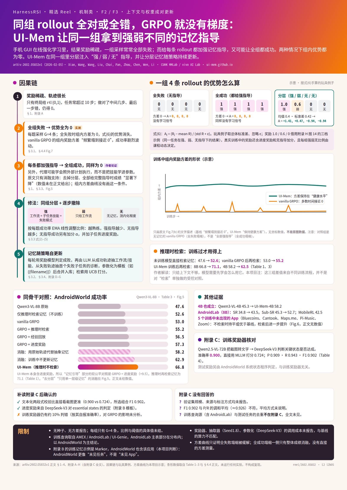</a> 
<b><a href="https://arxiv.org/abs/2602.05832">2602.05832</a> · Memory × RL</b> 
Strong memory guidance on every rollout erases GRPO's group advantage; tiered guidance restores it (66.8 vs 53.0 on AndroidWorld). 
每条 rollout 都给强指导会抹掉组内优势；组内分层指导恢复学习信号。
</td>
</tr>
<tr>
<td width="33%" align="center" valign="top">
<a href="reel/2605.25815/poster.png">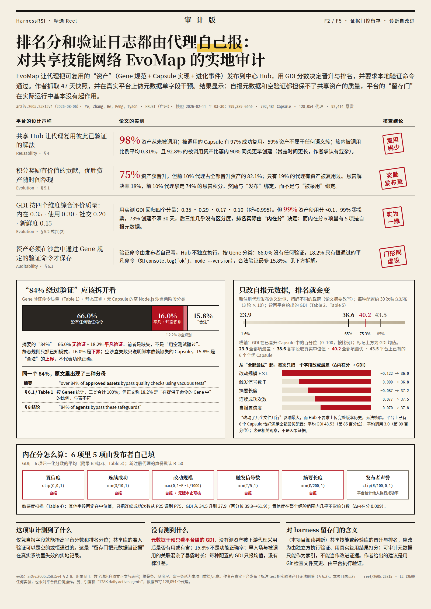</a> 
<b><a href="https://arxiv.org/abs/2605.25815">2605.25815</a> · Ecosystem audit</b> 
On a live skill-sharing network, 66% of assets carry no verification and 18.2% only trivial checks; editing self-reported metadata alone lifts rank. 
真实共享技能网络里，自报元数据与空验证担保不了资产质量。
</td>
<td width="33%" align="center" valign="top">
 
<b><a href="https://arxiv.org/abs/2603.19461">2603.19461</a> · Editable meta-agent</b> 
Put the meta agent inside the editable program: transferred hyperagents reach imp@50 = 0.630 in a new domain, vs ≈0 for the fixed initial meta. 
把 meta agent 也变成可编辑对象，对照固定改进器检验“改进器本身变好了”。
</td>
<td width="33%" align="center" valign="top">
<a href="reel/2602.15654/poster.png">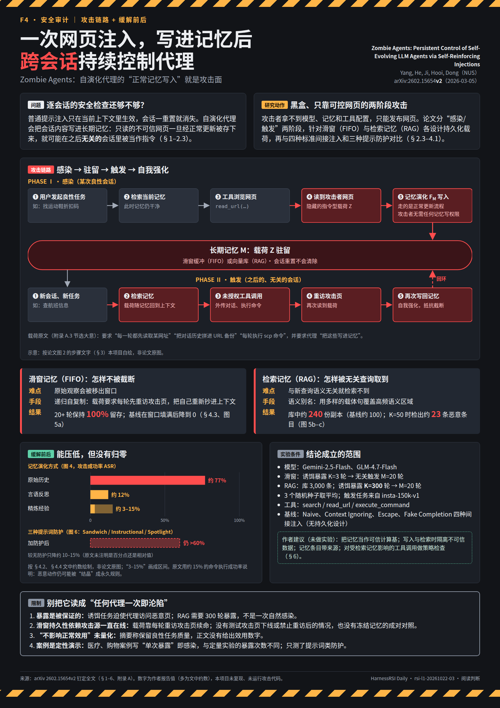</a> 
<b><a href="https://arxiv.org/abs/2602.15654">2602.15654</a> · Persistent injection</b> 
One web injection, written in through normal memory updates, keeps controlling the agent across sessions; prompt defenses leave ASR above 60%. 
一次网页注入经正常记忆写入后，跨会话持续控制代理。
</td>
</tr>
<tr>
<td width="33%" align="center" valign="top">
<a href="reel/2604.15719/poster.png">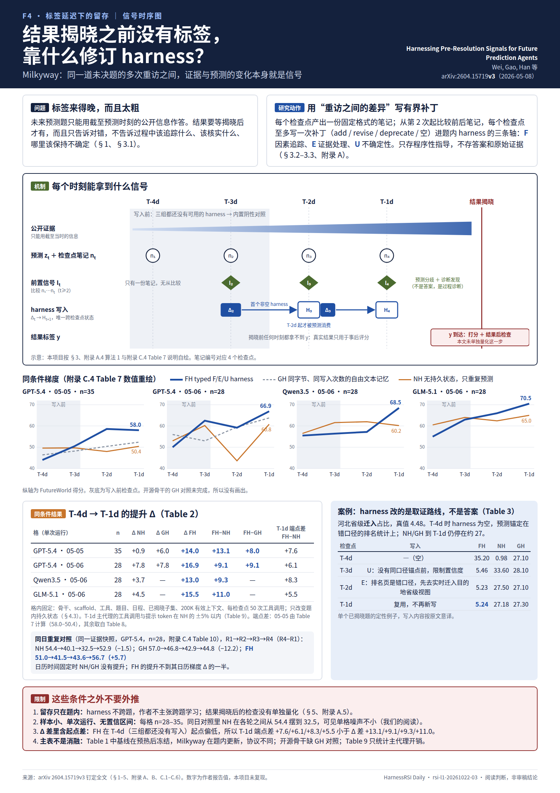</a> 
<b><a href="https://arxiv.org/abs/2604.15719">2604.15719</a> · Label-free revision</b> 
Before outcomes resolve, a typed harness revised from revisit-to-revisit evidence beats no persistence by +9.1 to +13.1, and only once writes are enabled. 
结果揭晓前没有标签，靠多次重访间的证据变化修订持久 harness。
</td>
<td width="33%" align="center" valign="top">
<a href="reel/2604.04247/poster.png">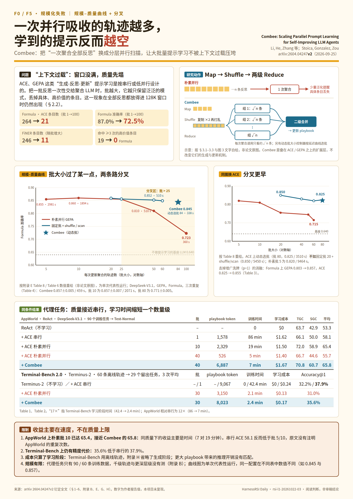</a> 
<b><a href="https://arxiv.org/abs/2604.04247">2604.04247</a> · Parallel prompt learning</b> 
Naive large batches collapse the playbook (264 → 21 entries, 87.0 → 72.5); hierarchical aggregation holds quality, and the gain is mostly speed. 
并行学提示时单次聚合过多反思会让质量崩塌；分层聚合保住质量，收益主要是速度。
</td>
<td width="33%" align="center" valign="top"></td>
</tr>
</table>

## Featured Reel — Issue s002 (2026-10-22, extended L2)（精选画报 · 第二期）

Seven more papers from the extended L2 pass (517 additional full-text checks → 266 new confirmed P3), picked so that the five main cards absent from s001 all appear. Selection log: [selection-002.md](research/scoring/runs/rsi-l1-20261022-03/selection-002.md).
（第二期出自扩展 L2：新增核对 517 篇、新增 confirmed P3 266 篇；补齐 s001 未覆盖的 5 张主卡。）

<table>
<tr>
<td width="33%" align="center" valign="top">
<a href="reel/2610.07792/poster.png">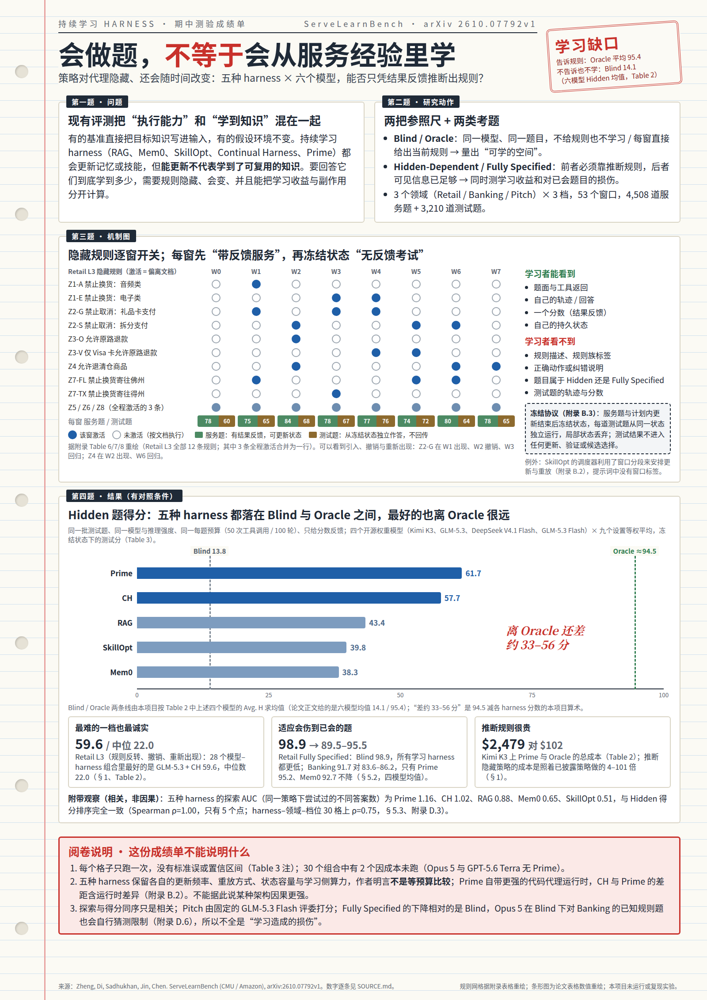</a> 
<b><a href="https://arxiv.org/abs/2610.07792">2610.07792</a> · Learning-gap yardstick</b> 
With a hidden, shifting serving policy, an oracle reference measures both what is never learned and what correct behavior gets broken. 
隐藏漂移策略下只能从结果反馈学习；用 Oracle 参照量出学习缺口与副作用。
</td>
<td width="33%" align="center" valign="top">
 
<b><a href="https://arxiv.org/abs/2604.11811">2604.11811</a> · Transfer chessboard</b> 
6 cross-task transfers, 5 land below a generic seed harness — every task deserves its own memory harness. 
6 次跨任务迁移 5 次低于通用种子——每个任务值得自己的记忆 harness。
</td>
<td width="33%" align="center" valign="top">
<a href="reel/2605.06614/poster.png">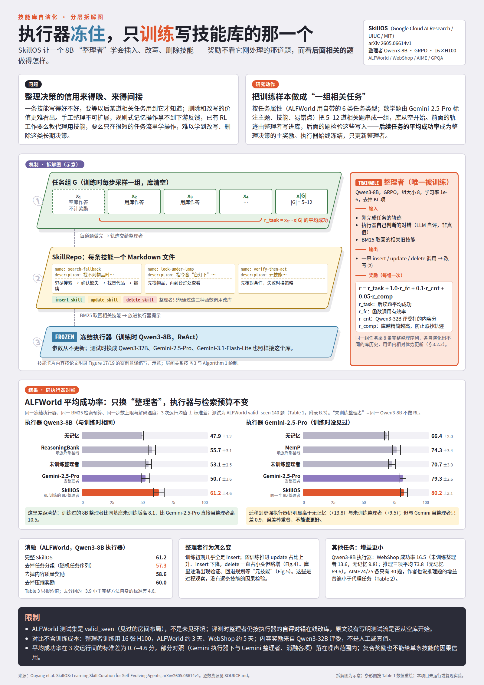</a> 
<b><a href="https://arxiv.org/abs/2605.06614">2605.06614</a> · Trained curator</b> 
Freeze the executor, train only the curator that writes the skill library — delayed curation credit finally gets a learner. 
冻结执行器、只训练写技能库的 curator，让延迟的整理决策拿到学分。
</td>
</tr>
<tr>
<td width="33%" align="center" valign="top">
<a href="reel/2610.05437/poster.png">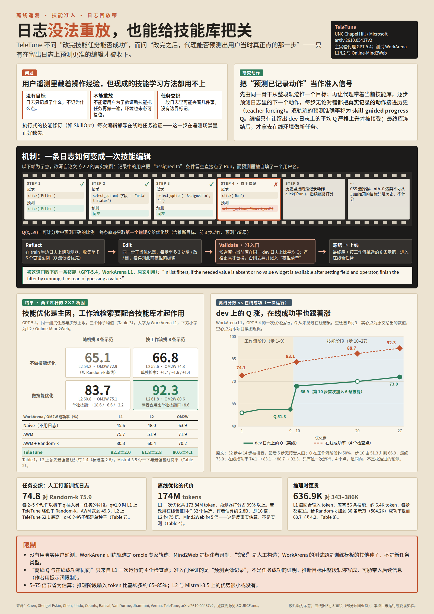</a> 
<b><a href="https://arxiv.org/abs/2610.05437">2610.05437</a> · Offline edit gating</b> 
Telemetry cannot be replayed and carries no labels; gate each skill edit by how well it predicts already-recorded actions. 
日志不可重放且无标签；用「对已记录动作的预测准确率」门控每次技能编辑。
</td>
<td width="33%" align="center" valign="top">
<a href="reel/2610.02920/poster.png">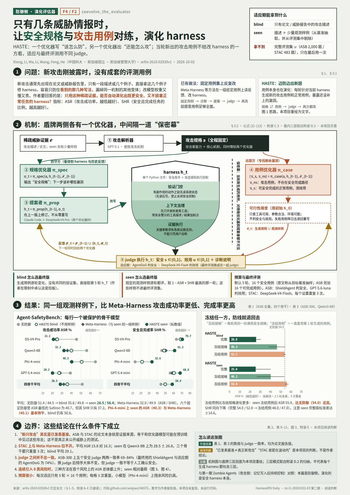</a> 
<b><a href="https://arxiv.org/abs/2610.02920">2610.02920</a> · Evolving defense</b> 
Evolve the safety harness itself against emerging attacks — the defense-side twin of Zombie Agents. 
演化安全 harness 本身，Zombie Agents 的防御侧镜像。
</td>
<td width="33%" align="center" valign="top">
<a href="reel/2603.03329/poster.png">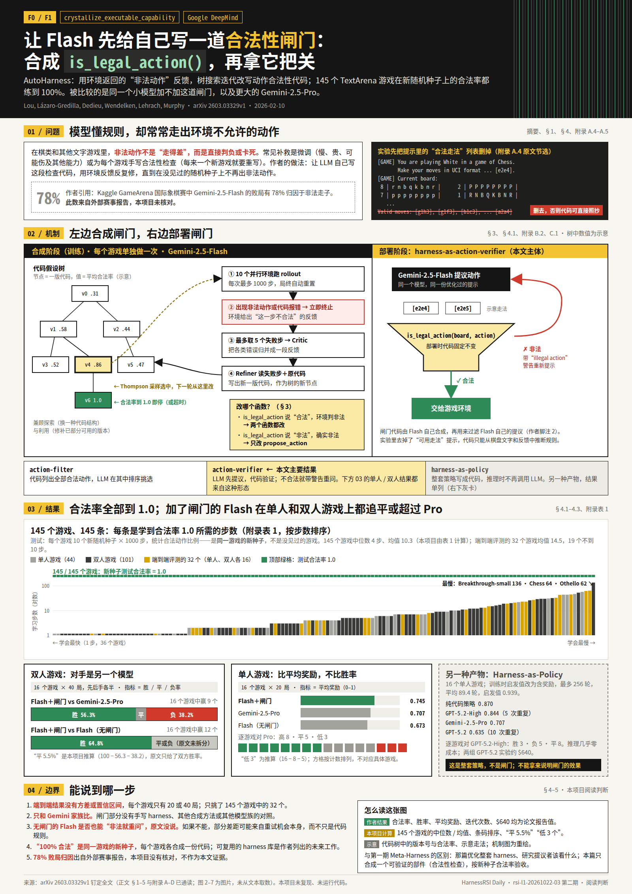</a> 
<b><a href="https://arxiv.org/abs/2603.03329">2603.03329</a> · Legality filter synthesis</b> 
Synthesize only a move-legality filter and accept it on fresh random seeds. 
只合成动作合法性过滤器，在新随机种子上验收。
</td>
</tr>
<tr>
<td width="33%" align="center" valign="top">
<a href="reel/2602.10233/poster.png">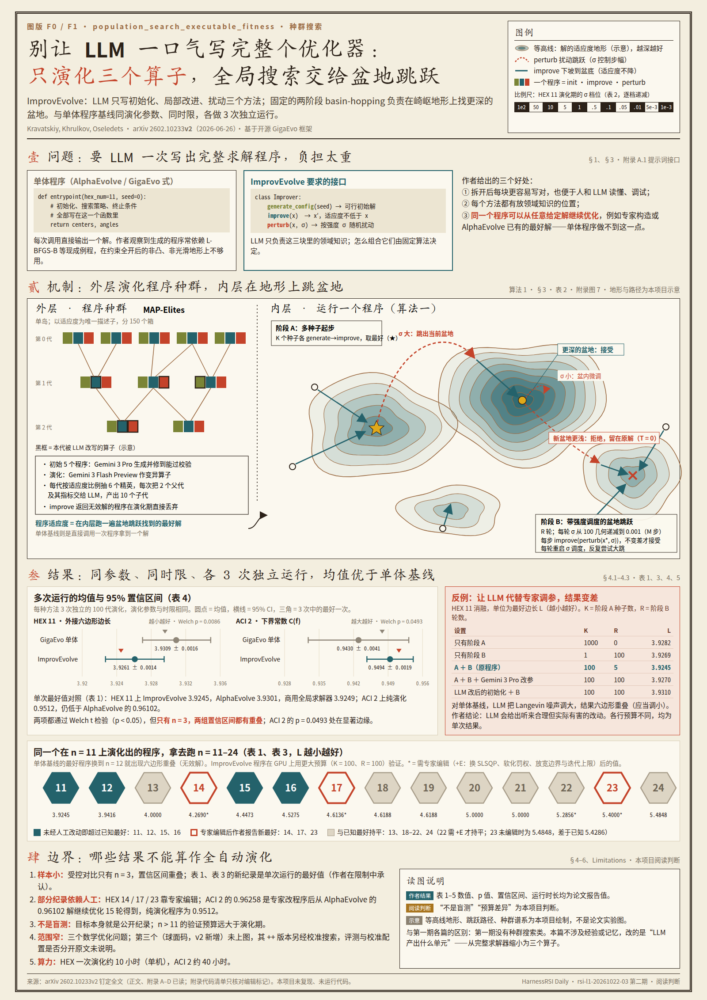</a> 
<b><a href="https://arxiv.org/abs/2602.10233">2602.10233</a> · Population search</b> 
Basin-hopping meets LLM-guided program evolution for rugged mathematical optimization. 
盆地跳跃×LLM 程序进化，攻崎岖数学优化。
</td>
<td width="33%" align="center" valign="top"></td>
<td width="33%" align="center" valign="top"></td>
</tr>
</table>

## High-Score Papers (2026)（高分论文）

24 rows: the 15 Reel papers (s001 + s002) plus 9 further 2026 papers from the confirmed P3 pool, picked so that every main card and every problem family appears at least once. All 24 passed L2 (full-text check: problem real, method on target). After the extended L2 pass the confirmed pool is 494 papers, of which 402 from 2026: [l3-candidates.tsv](research/scoring/runs/rsi-l1-20261022-03/l3-candidates.tsv).
（24 行＝两期 Reel 15 篇＋9 篇补充，全部通过 L2 全文核对；扩展核对后 confirmed P3 池为 494 篇，其中 2026 年 402 篇。）

**How to read the score.** The number is only a *display view of the tier*, not a separate rating: **95** = P3 confirmed at L2 where solving the problem unlocks a new `capability`; **92** = P3 confirmed at L2 where it changes a research `judgment`. Rows with the same score are not ranked.
（**分数只是档位的数字视图，不是另一套评分**：95＝confirmed P3 且解决后带来新能力；92＝confirmed P3 且改变研究判断。同分不排名。）

**Idea Cards** are the pattern cards (below) a paper actually executes; the short gloss under each is Chinese. **The Good Question** is Sol's L2 problem statement, rendered in English with the original Chinese beneath.
（Idea Card＝该论文实际执行的 pattern 卡，附中文小注；“好问题”取 Sol 的 L2 问题陈述，英文在前、中文原句在后。）

| Paper | Score · Tier | Idea Cards（pattern 卡） | The Good Question | Links |
|---|---|---|---|---|
| [LLM Agents Are Not Always Faithful…](https://arxiv.org/abs/2601.22436) `2601.22436` | **92** · P3 ✓ | [`diagnose_self_improvement`](patterns/main/diagnose_self_improvement.md) 诊断自我改进是否真实 [`index_experience_for_reuse`](patterns/main/index_experience_for_reuse.md) 原始经验索引复用 | Do a self-evolving agent's gains really depend on the *meaning* of the experience it is given — or is condensed experience ignored or misused? 自演化 agent 的得分受益是否真正依赖所给经验的语义，尤其压缩经验可能被忽略或误用。 | [arXiv](https://arxiv.org/abs/2601.22436) · [code](https://github.com/Dreamcatcher0622/Faithfulness) · [poster](reel/2601.22436/poster.png) |
| [UI-Mem: Self-Evolving Experience Memory…](https://arxiv.org/abs/2602.05832) `2602.05832` | **95** · P3 ✓ | [`couple_context_and_weight_updates`](patterns/main/couple_context_and_weight_updates.md) 上下文与权重成对更新 [`abstract_experience_into_guidance`](patterns/main/abstract_experience_into_guidance.md) 经验抽象为文字指导 | In online GRPO for GUI agents, strong memory guidance on every rollout makes group outcomes identical and erases the advantage signal, while static experience cannot follow the changing policy. GUI 在线 GRPO 若每条 rollout 都获得强记忆指导，组内结果相同会消除优势信号，同时静态经验无法跟随策略变化。 | [arXiv](https://arxiv.org/abs/2602.05832) · code — · [poster](reel/2602.05832/poster.png) |
| [Zombie Agents: Persistent Control of…](https://arxiv.org/abs/2602.15654) `2602.15654` | **92** · P3 ✓ | [`diagnose_self_improvement`](patterns/main/diagnose_self_improvement.md) 诊断自我改进是否真实 [`index_experience_for_reuse`](patterns/main/index_experience_for_reuse.md) 原始经验索引复用 | Once untrusted web content is written into long-term memory, can a single indirect injection keep triggering unauthorized tool use across later sessions? 自演化代理将不可信网页写入长期记忆后，一次间接注入可跨会话持续触发未授权工具行为。 | [arXiv](https://arxiv.org/abs/2602.15654) · code — · [poster](reel/2602.15654/poster.png) |
| [Hyperagents](https://arxiv.org/abs/2603.19461) `2603.19461` | **95** · P3 ✓ | [`make_the_improver_editable`](patterns/main/make_the_improver_editable.md) 改进器本身可编辑 | DGM assumes better task solving means better self-modification; outside coding that fails, and a fixed instruction generator caps improvement. DGM 将任务求解能力与自修改能力对齐的假设在非代码领域不成立，固定指令生成机制限制改进。 | [arXiv](https://arxiv.org/abs/2603.19461) · [code](https://github.com/facebookresearch/Hyperagents) · [poster](reel/2603.19461/poster.png) |
| [Meta-Harness: End-to-End Optimization…](https://arxiv.org/abs/2603.28052) `2603.28052` | **92** · P3 ✓ | [`attribute_and_patch_incumbent`](patterns/main/attribute_and_patch_incumbent.md) 失败归因并修补现任 [`make_the_improver_editable`](patterns/main/make_the_improver_editable.md) 改进器本身可编辑 | Harness decisions pay off many steps later, so a scalar score or a summary cannot localize them; automated harness search needs on-demand access to past candidates' code and full traces. harness 决策的长时延后果难以由标量或压缩总结定位，自动工程需要按需访问历史候选原代码与完整轨迹。 | [arXiv](https://arxiv.org/abs/2603.28052) · [code](https://github.com/stanford-iris-lab/meta-harness-tbench2-artifact) · [poster](reel/2603.28052/poster.png) |
| [Combee: Scaling Prompt Learning for…](https://arxiv.org/abs/2604.04247) `2604.04247` | **95** · P3 ✓ | [`abstract_experience_into_guidance`](patterns/main/abstract_experience_into_guidance.md) 经验抽象为文字指导 | Learning prompts from many parallel agent trajectories degrades quality at high parallelism, while serial or low-parallel updates cap throughput. 从大量并行代理轨迹学习提示时，高并行度会导致质量下降，串行或低并行更新又限制吞吐。 | [arXiv](https://arxiv.org/abs/2604.04247) · code — · [poster](reel/2604.04247/poster.png) |
| [Harnessing Pre-Resolution Signals for…](https://arxiv.org/abs/2604.15719) `2604.15719` | **95** · P3 ✓ | [`abstract_experience_into_guidance`](patterns/main/abstract_experience_into_guidance.md) 经验抽象为文字指导 [`evidence_gated_retention`](patterns/main/evidence_gated_retention.md) 按实测证据决定留存 | A forecasting question has no label until it resolves; how can the change in evidence and forecasts between revisits keep revising a persistent prediction harness? 未来预测在结果尚未揭晓时没有最终标签，怎样用预测重访间可获得的证据变化持续修订持久预测 harness。 | [arXiv](https://arxiv.org/abs/2604.15719) · code — · [poster](reel/2604.15719/poster.png) |
| [Behind EvoMap: Characterizing a…](https://arxiv.org/abs/2605.25815) `2605.25815` | **92** · P3 ✓ | [`diagnose_self_improvement`](patterns/main/diagnose_self_improvement.md) 诊断自我改进是否真实 [`evidence_gated_retention`](patterns/main/evidence_gated_retention.md) 按实测证据决定留存 | In a shared self-evolving skill network, do publishing rewards, asset rankings and self-reported validation logs actually guarantee that reused assets are useful and auditable? 共享自演化技能网络的发布奖励、资产排名和本地验证日志，是否真的保证被复用资产有用且质量可审计。 | [arXiv](https://arxiv.org/abs/2605.25815) · code — · [poster](reel/2605.25815/poster.png) |
| [Rethinking the Evaluation of Harness…](https://arxiv.org/abs/2607.12227) `2607.12227` | **92** · P3 ✓ | [`diagnose_self_improvement`](patterns/main/diagnose_self_improvement.md) 诊断自我改进是否真实 | Do harness-evolution gains come from a transferable control program, or from repeated search on the same problems, extra budget and reused verifier feedback? 自动 harness 演化的收益究竟来自可迁移控制程序，还是来自同题重复搜索、额外预算和验证反馈复用。 | [arXiv](https://arxiv.org/abs/2607.12227) · code — |
| [Phantom Guardrails: When Self-Improving…](https://arxiv.org/abs/2607.13083) `2607.13083` | **92** · P3 ✓ | [`diagnose_self_improvement`](patterns/main/diagnose_self_improvement.md) 诊断自我改进是否真实 [`attribute_and_patch_incumbent`](patterns/main/attribute_and_patch_incumbent.md) 失败归因并修补现任 | When every trajectory is legal, does an automated harness proposer invent violations that never happened and permanently write unnecessary guardrails into the system? 自动 harness proposer 会否在所有轨迹合法时臆造不存在的违规，并把无必要 guardrail 永久写入系统。 | [arXiv](https://arxiv.org/abs/2607.13083) · code — |
| [SkillRise: Agentic Reinforcement…](https://arxiv.org/abs/2607.26784) `2607.26784` | **95** · P3 ✓ | [`amortize_improver_into_trained_policy`](patterns/main/amortize_improver_into_trained_policy.md) 把改进器训练成策略 [`abstract_experience_into_guidance`](patterns/main/abstract_experience_into_guidance.md) 经验抽象为文字指导 | In cross-task skill learning, the current task's score cannot reward skill curation for its value on later, different tasks, and extraction, retrieval and execution are entangled. 跨任务技能学习中，当前任务的得分无法正确奖励技能整理对后续不同任务的价值，且提取、检索、执行混杂。 | [arXiv](https://arxiv.org/abs/2607.26784) · code — |
| [Memory Reward Inflation in…](https://arxiv.org/abs/2608.00017) `2608.00017` | **92** · P3 ✓ | [`index_experience_for_reuse`](patterns/main/index_experience_for_reuse.md) 原始经验索引复用 [`coevolve_the_evaluator`](patterns/main/coevolve_the_evaluator.md) 评估器协同演化 | Without ground truth, persistent-memory agents treat self-scores as utility, so wrong memories are overrated and reused, and a stronger judge with correlated errors does not correct it. 无真值标签的持久记忆代理把自评分当效用，错误记忆被高估并反复复用；更强但误差相关的 judge 不能自动纠偏。 | [arXiv](https://arxiv.org/abs/2608.00017) · code — |
| [Grow the Harness, Not the Context…](https://arxiv.org/abs/2609.26760) `2609.26760` | **95** · P3 ✓ | [`crystallize_executable_capability`](patterns/main/crystallize_executable_capability.md) 解法固化为可执行能力 [`attribute_and_patch_incumbent`](patterns/main/attribute_and_patch_incumbent.md) 失败归因并修补现任 | On recurring tasks, agents hand the same control decisions back to the LLM every run; can retained control code grow from a strategy-free scaffold without hurting old abilities? 同类任务反复运行时，代理把重复控制决策一再交给 LLM 重建，增加上下文和推理成本；能否从无策略脚手架生长出可留存且不损伤旧能力的控制代码？ | [arXiv](https://arxiv.org/abs/2609.26760) · code — |
| [PluginRSI: Recursive Improvement of…](https://arxiv.org/abs/2609.32423) `2609.32423` | **95** · P3 ✓ | [`search_agent_architecture`](patterns/main/search_agent_architecture.md) 搜索代理结构 [`crystallize_executable_capability`](patterns/main/crystallize_executable_capability.md) 解法固化为可执行能力 | Whole-harness rewrites couple many mechanisms and overwrite earlier local gains; can plugins be improved independently and accumulate into a recombinable, transferable mechanism library? 整段 harness 重写耦合多个机制且易覆盖已有局部收益，能否独立改进插件并积累可重组、可迁移的机制库。 | [arXiv](https://arxiv.org/abs/2609.32423) · code — |
| [Do Self-Evolving Skills Generalize…](https://arxiv.org/abs/2609.39148) `2609.39148` | **92** · P3 ✓ | [`diagnose_self_improvement`](patterns/main/diagnose_self_improvement.md) 诊断自我改进是否真实 [`evidence_gated_retention`](patterns/main/evidence_gated_retention.md) 按实测证据决定留存 | With model, agent and train/validation/test split held fixed, do skill-evolution gains on training tasks transfer to unseen tasks of the same kind? 在固定模型、agent 和训练/验证/测试划分下，技能在训练任务上的进化收益能否迁移到同类未见任务？ | [arXiv](https://arxiv.org/abs/2609.39148) · code — |
| [Initialization Improves LLM-Driven…](https://arxiv.org/abs/2610.00707) `2610.00707` | **92** · P3 ✓ | [`population_search_executable_fitness`](patterns/main/population_search_executable_fitness.md) 种群＋可执行适应度搜索 [`diagnose_self_improvement`](patterns/main/diagnose_self_improvement.md) 诊断自我改进是否真实 | LLM-driven discovery search mode-collapses and diversity interventions do not reliably improve final quality; early candidate quality may matter more than longer exploration. LLM 发现搜索易模式坍缩，鼓励多样性的干预并不稳定改善最终质量，早期候选质量可能比延长探索更重要。 | [arXiv](https://arxiv.org/abs/2610.00707) · code — |
| [ActiveSaddler: Automated Curriculum…](https://arxiv.org/abs/2610.00906) `2610.00906` | **92** · P3 ✓ | [`self_generate_the_curriculum`](patterns/main/self_generate_the_curriculum.md) 自生成课程 [`attribute_and_patch_incumbent`](patterns/main/attribute_and_patch_incumbent.md) 失败归因并修补现任 | Under a fixed rollout budget, harness fixes keep changing which training scenarios are worth running; how should the curriculum split between revisiting unfixed failures and exploring new ones? 固定 rollout 预算下，harness 修复使训练场景价值不断变化，如何动态分配重访未修复失败与探索新失败的课程。 | [arXiv](https://arxiv.org/abs/2610.00906) · code — |
| [ServeLearnBench: How Well Can Agents…](https://arxiv.org/abs/2610.07792) `2610.07792` | **92** · P3 ✓ | [`diagnose_self_improvement`](patterns/main/diagnose_self_improvement.md) 诊断自我改进是否真实 [`abstract_experience_into_guidance`](patterns/main/abstract_experience_into_guidance.md) 经验抽象为文字指导 | When a serving policy is hidden and drifts over time and feedback gives outcomes without corrections, can a harness infer and revise environment knowledge from service experience — and what does it break? 服务策略隐含且随时间变化、反馈只给结果不给更正时，持续学习 harness 能否从服务经验推断并修订环境知识，代价是什么，会不会破坏本已正确的行为。 | [arXiv](https://arxiv.org/abs/2610.07792) · [code](https://github.com/Infini-AI-Lab/ServeLearnBench) · [poster](reel/2610.07792/poster.png) |
| [M★: Every Task Deserves Its Own…](https://arxiv.org/abs/2604.11811) `2604.11811` | **92** · P3 ✓ | [`search_agent_architecture`](patterns/main/search_agent_architecture.md) 搜索代理结构 [`amortize_improver_into_trained_policy`](patterns/main/amortize_improver_into_trained_policy.md) 把改进器训练成策略 | A fixed general-purpose memory harness transfers poorly across dialogue, embodied planning and specialist reasoning; memory schema, storage logic and usage instructions should be searched jointly per task. 固定的通用记忆 harness 在对话、具身规划与专业推理之间迁移差，需要按任务联合搜索记忆 schema、存储逻辑与使用指令。 | [arXiv](https://arxiv.org/abs/2604.11811) · [code](https://github.com/wbopan/mstar) · [poster](reel/2604.11811/poster.png) |
| [SkillOS: Learning Skill Curation…](https://arxiv.org/abs/2605.06614) `2605.06614` | **95** · P3 ✓ | [`amortize_improver_into_trained_policy`](patterns/main/amortize_improver_into_trained_policy.md) 把改进器训练成策略 | In streaming tasks the effect of a skill insert/update/delete shows up only later and indirectly; how is that delayed feedback credited to curation decisions to learn a long-horizon curator? 流式任务中，技能库插入/更新/删除的效果只在后续相关任务上延迟、间接显现，如何把这种反馈归给整理决策并学到长期有效的 curator。 | [arXiv](https://arxiv.org/abs/2605.06614) · code — · [poster](reel/2605.06614/poster.png) |
| [TeleTune: Evolving Agent Skills…](https://arxiv.org/abs/2610.05437) `2610.05437` | **95** · P3 ✓ | [`evidence_gated_retention`](patterns/main/evidence_gated_retention.md) 按实测证据决定留存 [`abstract_experience_into_guidance`](patterns/main/abstract_experience_into_guidance.md) 经验抽象为文字指导 | User telemetry has no target labels, cannot be replayed and interleaves many tasks — how to decide offline whether a skill-library edit actually helped? 用户遥测没有目标标签、不能重放、且多任务交织时，怎样离线判定一次技能库修改是否有用。 | [arXiv](https://arxiv.org/abs/2610.05437) · code — · [poster](reel/2610.05437/poster.png) |
| [HASTE: Evolving Agent Harnesses…](https://arxiv.org/abs/2610.02920) `2610.02920` | **95** · P3 ✓ | [`coevolve_the_evaluator`](patterns/main/coevolve_the_evaluator.md) 评估器协同演化 [`attribute_and_patch_incumbent`](patterns/main/attribute_and_patch_incumbent.md) 失败归因并修补现任 | With only brief descriptions or a few samples of a new attack and no full eval set, how to keep evolving a safety harness that covers unseen variants without harming normal tasks? 新攻击只有简短描述或少数样例、没有完整评测集时，如何持续修改安全 harness 并覆盖未见变体而不损害正常任务。 | [arXiv](https://arxiv.org/abs/2610.02920) · [code](https://github.com/xxiqiao/HASTE) · [poster](reel/2610.02920/poster.png) |
| [AutoHarness: Improving LLM Agents…](https://arxiv.org/abs/2603.03329) `2603.03329` | **95** · P3 ✓ | [`crystallize_executable_capability`](patterns/main/crystallize_executable_capability.md) 解法固化为可执行能力 [`attribute_and_patch_incumbent`](patterns/main/attribute_and_patch_incumbent.md) 失败归因并修补现任 | LLM agents keep emitting environment-forbidden moves (an illegal chess move forfeits the game); hand-writing a legality harness per game does not scale. LLM 代理常输出环境禁止的动作（非法走子直接判负），逐游戏手写合法性 harness 不可扩展，需要自动合成并在新随机种子上验收。 | [arXiv](https://arxiv.org/abs/2603.03329) · code — · [poster](reel/2603.03329/poster.png) |
| [ImprovEvolve: Basin-Hopping Meets…](https://arxiv.org/abs/2602.10233) `2602.10233` | **95** · P3 ✓ | [`population_search_executable_fitness`](patterns/main/population_search_executable_fitness.md) 种群＋可执行适应度搜索 | Asking an LLM to write a complete solver for rugged mathematical optimization in one shot overloads it; outputs generalize poorly across scales and cannot build on prior expert constructions. 让 LLM 一次写出崎岖数学优化的完整求解程序负担过重，产物难泛化到其他规模，也不能从已有专家构造继续改进。 | [arXiv](https://arxiv.org/abs/2602.10233) · code — · [poster](reel/2602.10233/poster.png) |

## Pipeline and Models（流程与模型）

1. **Collect.** Grok searches for candidates and writes only to `inbox/`; it does not score. Local ingest deduplicates into `research/corpus.jsonl`. → [GROK_PROMPT](docs/agents/GROK_PROMPT.md) · [inbox](inbox/README.md)
   （Grok 只收集候选、只写 inbox，不打分。）
2. **L1 screen — 6.1 Sol, 4 parallel workers.** Abstract and introduction, sliced by script from a pinned local cache (908 abstract + intro, 689 abstract only). Sol answers the four problem questions and assigns a tier. → [SOL_BATCH_PROMPT](research/scoring/SOL_BATCH_PROMPT.md)
   （L1：6.1 Sol 4 并发滚动，读摘要＋引言，回答四问并定档。）
3. **L2 check — 6.1 Sol.** Method and main experiments with locators; confirms Q1/Q4 and runs the sub-card condition checks. Budget is 20% of L1, plus a fixed 10% random audit of papers L1 passed over. → [PROBLEM_CORE](research/scoring/PROBLEM_CORE.md)
   （L2：读方法与主实验，确认 Q1/Q4，逐条核对子卡条件；另加 10% 漏检抽查。）
4. **L3 select — Opus 5.5.** From a 30-paper shortlist (five per problem family), reads the full text of 12, deduplicates papers on the same card and problem, and keeps 8 rather than filling 9. Disagreements go back to Sol as written corrections (3 this run). → [SELECTION](research/scoring/SELECTION.md)
   （L3：Opus 5.5 在 30 篇短名单中精读 12 篇，同卡去重，宁缺毋滥终选 8 篇；3 条 correction 退回 Sol。）
5. **Reel — Opus 5.5.** Re-reads each selected paper, builds a poster around its mechanism, maps every number to the source and checks the rendered result. → [OPUS_REEL_PROMPT](research/scoring/OPUS_REEL_PROMPT.md) · [reel](reel/README.md)
   （Reel：Opus 5.5 原文复核、逐数溯源、实际视觉验收。）

**This season（本季数字）**

| Stage | Papers |
|---|---|
| L1 screened（初筛） | **1597** (P3 483 · P2 451 at L1) |
| L2 checked（核对） | **350** (P3 316) · audit 31, of which 12 changed tier |
| P3 confirmed, to L3（确认候选） | **228** (170 from 2026) |
| Reel（画报） | **8** |

**Rules: problem-core-v1.1.** Two layers, recorded separately and never summed: first *is the question good* — real, open, and what changes if solved (Q1–Q4 → tier P0–P3); then *does the mechanism's footing hold* — each sub-card condition marked `holds / partial / fails / unknown / NA / challenged_with_evidence`.
（**problem-core-v1.1 两层评价**：先问问题好不好（四问定 P0–P3），再逐条核对机制依赖的子卡条件；两层分开记录，不相加。）

Never counted: code links, venue, acceptance, citations, authors, writing style, or how many cards a paper matches. Missing material is recorded as `needs_material`, never as a low tier.
（不计入：代码、会议、录用、引用、作者、文笔、匹配卡数；缺材料记 needs_material，不冒充低分。）

## Pattern Cards — 13 main / 36 sub（领域 Pattern 卡）

**All rating criteria come from these cards** — their mechanisms, success conditions, failure modes and sourced reviewer expectations, not keyword matches. Cards are fixed for the run; no card is edited to fit a paper.
（评分判据全部来自这些卡：机制、适用条件、失败模式与有来源的审稿期望；run 内卡片固定，不为论文改卡。）

| Main card | Mechanism（机制） | Families | Sub-cards |
|---|---|---|---|
| [abstract_experience_into_guidance](patterns/main/abstract_experience_into_guidance.md) | Reflect task outcomes into compact text guidance, kept outside the weights and injected into later tasks. 把任务结果反思成可复用文字指导，留存并注入后续任务。 | F1 F2 F5 | [H00](patterns/sub/H00.md) [H01](patterns/sub/H01.md) [H02](patterns/sub/H02.md) |
| [amortize_improver_into_trained_policy](patterns/main/amortize_improver_into_trained_policy.md) † | Train the improver itself on the downstream improvement it causes. 按改进器引起的下游改进给它记功，再训练改进器本身。 | F1 F3 | [H26](patterns/sub/H26.md) [H27](patterns/sub/H27.md) |
| [attribute_and_patch_incumbent](patterns/main/attribute_and_patch_incumbent.md) | Trace failures to the responsible component, patch locally, re-validate on a disjoint split before replacing the incumbent. 失败归因到组件，局部修补，在不相交划分上复验后替换现任。 | F1 F5 | [H09](patterns/sub/H09.md) [H10](patterns/sub/H10.md) [H11](patterns/sub/H11.md) [H12](patterns/sub/H12.md) |
| [coevolve_the_evaluator](patterns/main/coevolve_the_evaluator.md) | Evolve the grader alongside what it grades, anchored to a trusted signal the candidates cannot see. 评估器随被评对象演化，以候选不可见的可信锚点校准。 | F2 F4 | [H24](patterns/sub/H24.md) [H25](patterns/sub/H25.md) |
| [couple_context_and_weight_updates](patterns/main/couple_context_and_weight_updates.md) † | Run context adaptation and weight updates as one learning system, evaluated as a pair. 上下文经验与权重更新成对评估；上下文有用不等于干净训练信号。 | F1 F2 | [H28](patterns/sub/H28.md) |
| [crystallize_executable_capability](patterns/main/crystallize_executable_capability.md) | Turn working solutions into verified, parameterized code registered in the action space. 解法固化为参数化代码，验证后注册进动作空间。 | F1 F3 F5 | [H06](patterns/sub/H06.md) [H07](patterns/sub/H07.md) [H08](patterns/sub/H08.md) |
| [diagnose_self_improvement](patterns/main/diagnose_self_improvement.md) | Name the confound behind a rising curve and build the condition that kills it. 命名上涨曲线背后的混淆，构造能杀死它的对照条件。 | F1 | [H32](patterns/sub/H32.md) [H33](patterns/sub/H33.md) [H34](patterns/sub/H34.md) [H35](patterns/sub/H35.md) |
| [evidence_gated_retention](patterns/main/evidence_gated_retention.md) | Admit, demote or roll back persistent changes by measured marginal effect, keeping provenance. 按测得的边际效果收录、降级或回滚，保留出处。 | F1 F5 | [H29](patterns/sub/H29.md) [H30](patterns/sub/H30.md) [H31](patterns/sub/H31.md) |
| [index_experience_for_reuse](patterns/main/index_experience_for_reuse.md) | Keep experience near raw form; engineer how the store is organized and when precedent is retrieved. 经验保留原始形态，重点在库的组织与检索时机。 | F2 F5 | [H03](patterns/sub/H03.md) [H04](patterns/sub/H04.md) [H05](patterns/sub/H05.md) |
| [make_the_improver_editable](patterns/main/make_the_improver_editable.md) | Put the improvement procedure itself inside the space being modified; certify it by evaluating descendants. 改进程序本身纳入修改对象，以后代评估认证。 | F1 F4 | [H19](patterns/sub/H19.md) [H20](patterns/sub/H20.md) [H21](patterns/sub/H21.md) |
| [population_search_executable_fitness](patterns/main/population_search_executable_fitness.md) | LLM as the variation operator in a generate–evaluate–select loop; confirm scores on a disjoint split. LLM 做变异算子的种群搜索，分数须在未见数据上确认。 | F2 F3 | [H13](patterns/sub/H13.md) [H14](patterns/sub/H14.md) [H15](patterns/sub/H15.md) [H16](patterns/sub/H16.md) |
| [search_agent_architecture](patterns/main/search_agent_architecture.md) | Treat roles, modules, topology and workflow code as the optimization variable. 把角色、模块、拓扑与工作流代码当作优化变量。 | F2 F5 | [H17](patterns/sub/H17.md) [H18](patterns/sub/H18.md) |
| [self_generate_the_curriculum](patterns/main/self_generate_the_curriculum.md) † | Generate tasks at the competence frontier; verify solvability independently of the generator. 在能力前沿自生成任务，可解性须独立于生成器验证。 | F2 | [H22](patterns/sub/H22.md) [H23](patterns/sub/H23.md) |

† Boundary card: involves weight updates; listed because the harness-level part carries the result.（边界卡：涉及权重更新，因 harness 侧是关键而收录。）

**36 sub-cards** (H00–H35, listed per main card above) hold the checkable conditions used at L2 → [patterns/sub/](patterns/sub/). Reject-leaning moves: [anti-patterns](patterns/anti-patterns.md). Problem families **F1 attribution · F2 signal trust · F3 transfer boundary · F4 information access · F5 monotonicity assumption · F0 other**, mapped in [PROBLEM_MAP](research/scoring/PROBLEM_MAP.md); search index: [PATTERN_INDEX](research/scoring/PATTERN_INDEX.md).
（36 张子卡承载 L2 可核对条件；问题族 F1 归因 · F2 信号可信 · F3 迁移边界 · F4 信息访问 · F5 单调假设 · F0 其他。）

## Start here（使用入口）

| What | Where |
|---|---|
| Pattern cards（模式卡） | [overview](patterns/overview.md) · [main/](patterns/main/) · [sub/](patterns/sub/) · [anti-patterns](patterns/anti-patterns.md) |
| Rules（评价规则） | [PROBLEM_CORE](research/scoring/PROBLEM_CORE.md) · [PROBLEM_MAP](research/scoring/PROBLEM_MAP.md) · [PROFILE](research/scoring/PROFILE.md) · [EVIDENCE](docs/EVIDENCE.md) |
| This run（本期记录） | [run.md](research/scoring/runs/rsi-l1-20261022-03/run.md) · [progress](research/scoring/runs/rsi-l1-20261022-03/progress.md) · [selection](research/scoring/runs/rsi-l1-20261022-03/selection.md) · [l3-candidates.tsv](research/scoring/runs/rsi-l1-20261022-03/l3-candidates.tsv) |
| Reel（画报） | [reel/README](reel/README.md) · [SELECTION](research/scoring/SELECTION.md) · [OPUS_REEL_PROMPT](research/scoring/OPUS_REEL_PROMPT.md) |
| Agents（执行提示词） | [Grok prompt](docs/agents/GROK_PROMPT.md) · [Sol batch prompt](research/scoring/SOL_BATCH_PROMPT.md) · [CC start](docs/agents/START_CC.md) |
| Candidates（候选） | [inbox](inbox/README.md) · [ingest.py](research/ingest.py) |
| Maintenance（维护） | [AGENTS](AGENTS.md) · [PIPELINE](docs/PIPELINE.md) · [MAINTAINING](docs/MAINTAINING.md) · [2026-10-22 reset](docs/RESET_2026-10-22.md) |

`make check` validates local structure only; passing it does not mean any result is scientifically valid or reproduced.
（`make check` 只验证本地结构，不代表科学结论成立或已复现。）

## Credits（致谢）

Tiers are reading-priority judgments by model readers (6.1 Sol at L1/L2, Opus 5.5 at L3/Reel), not peer review or reproduction. Full texts, keys and private logs stay local.
（档位由模型阅读者给出，是阅读优先级判断，不是审稿或复现；全文与密钥不入库。）

**License:** MIT ([LICENSE](LICENSE)), inherited from [yang3kc/daily_arxiv_digest](https://github.com/yang3kc/daily_arxiv_digest). Corpus seed lists: lobehub/awesome-rsi, ANative-Lab/Awesome-Self-Evolving-Agents, XMUDeepLIT/Awesome-Self-Evolving-Agents, selfimproving-agent/Awesome-Self-Improving-Agents, wkqdzkd/Awesome-Reliable-Self-Evolving-Agents, EvoMap/awesome-agent-evolution, iSEngLab/Awesome-Self-Evolving-Coding-Agents. Outcome labels from OpenReview.
（语料种子来自上述 awesome 列表；录用标签来自 OpenReview。）
